# Documentația Proiectului Beeline VoyageRail (PROJECT_DOCUMENTATION.md)

**Disciplina:** Baze de Date Avansate (BD2)  
**Titular curs:** Asist. univ. dr. Cristian Sandu, Universitatea „Dunărea de Jos” din Galați  
**Etape acoperite:** Etapa 0 (Domeniul temei), Etapa 1 (Modelarea datelor și Fixtures), Etapa 2 (Operații CRUD și Documentarea paginilor din interfață)  
**Student:** Andrei Iordache  
**Data:** Semestrul I, An universitar 2026–2027  

---

# ETAPA 0: Descrierea Domeniului Temei

## 1. Viziunea și Obiectivele Platformei Beeline
**Beeline VoyageRail** este o platformă modernă, la scară enterprise, dedicată planificării călătoriilor interurbane feroviare și multimodale pe teritoriul României, cu suport complet pentru transferuri urbane (metrou, tramvai, autobuz), predicția avansată a întârzierilor și emiterea biletelor de călătorie.

### 1.1 Problematica Tranzitului Feroviar și Multimodal în România
Sistemul feroviar românesc este deservit de o multitudine de operatori independenți (CFR Călători, Astra Trans Carpatic, Transferoviar Călători, Regio Călători, Interregional Călători), fiecare operând sisteme de ticketing izolate, formate eterogene de date și canale de informare fragmentate. Pentru călătorii care doresc să efectueze un traseu combinat (de exemplu: *cartier Micro 19 Galați ➔ Transurb Bus 102 ➔ Gara Galați ➔ Tren IR 1572 ➔ Gara de Nord București ➔ Metrorex M2 ➔ Piața Unirii*), nu există un sistem integrat care să calculeze timpul real de transfer, riscul de pierdere a legăturilor cauzat de lucrările de infrastructură și să permită achiziția biletelor dintr-un singur punct.

### 1.2 Soluția Propusă de Beeline
Beeline VoyageRail rezolvă această fragmentare prin:
1. **Unificarea Catalogului Feroviar și Urban:** Agregarea orarelor, disponibilității claselor de călătorie (`STANDARD`, `FIRST`, `BUSINESS`, `SLEEPER`) și a dotărilor de bord (Wi-Fi, prize, vagon restaurant, locuri biciclete, acces scaune rulante) într-o schemă unificată.
2. **Motorul de Rutare „Trifecta”:** Generarea a 3 alternative curate de călătorie:
   - `FASTEST` (Cea mai rapidă legătură);
   - `BEST_VALUE` (Cost minim pe călătorie);
   - `MOST_RELIABLE` (Siguranță maximă a transferurilor, cu buffere temporale optime).
3. **Romanian Transfer Shield & Pipeline ML de Risc:** Un modul avansat de inferență bazat pe LightGBM și ONNX Runtime care analizează în timp real riscul de conexiune ratată pe baza istoricului de întârzieri, a datelor meteo ANM și a incidentelor active pe magistrale.
4. **Portofel Digital de Călătorie & Bilete:** Rezervarea biletelor cu referință unică `BEE-XXXX`, generare de coduri QR securizate pentru controlori și stocarea itinerariilor favorite în cloud.

---

# ETAPA 1: Modelul de Date și Fixtures Automate

## 1. Schema Bazei de Date Relaționale (PostgreSQL 16)

Sistemul utilizează **12 tabele relaționale**, normalizate până la 3NF, cu constrângeri explicite de integritate referențială, unicitate și constrângeri de domeniu (`CHECK`).

### 1.1 Diagrama Entitate-Relație (Mermaid ER)

```mermaid
erDiagram
    users ||--o{ user_sessions : "has"
    users ||--o| mfa_credentials : "secures"
    users ||--o{ password_reset_tokens : "requests"
    users ||--o{ saved_routes : "saves"
    users ||--o{ bookings : "places"
    users ||--o{ idempotency_records : "claims"
    bookings ||--o{ tickets : "contains"
    stations ||--o{ trains : "originates"
    stations ||--o{ trains : "terminates"

    users {
        VARCHAR_36 id PK
        VARCHAR_255 email UK
        VARCHAR_255 username UK
        VARCHAR_255 hashed_password
        VARCHAR_255 full_name
        VARCHAR_32 role "CHECK (TRAVELER, OPERATOR, ADMIN)"
        TEXT preferences
        BOOLEAN is_guest
        BOOLEAN is_active
        BOOLEAN mfa_enabled
        TIMESTAMP created_at
        TIMESTAMP updated_at
    }

    user_sessions {
        VARCHAR_36 id PK
        VARCHAR_36 user_id FK
        VARCHAR_64 refresh_token_hash
        VARCHAR_255 device_info
        VARCHAR_64 ip_address
        BOOLEAN is_revoked
        TIMESTAMP created_at
        TIMESTAMP last_active_at
        TIMESTAMP expires_at
    }

    mfa_credentials {
        VARCHAR_36 id PK
        VARCHAR_36 user_id FK,UK
        VARCHAR_64 secret_key
        TEXT backup_codes_hash
        BOOLEAN is_confirmed
        TIMESTAMP created_at
        TIMESTAMP updated_at
    }

    password_reset_tokens {
        VARCHAR_36 id PK
        VARCHAR_36 user_id FK
        VARCHAR_64 token_hash
        TIMESTAMP expires_at
        BOOLEAN is_used
        TIMESTAMP created_at
    }

    stations {
        VARCHAR_16 code PK "ex. BCT, GLT"
        VARCHAR_255 name
        VARCHAR_100 city
        REAL latitude "CHECK (-90..90)"
        REAL longitude "CHECK (-180..180)"
        TEXT modes "JSON: TRAIN, METRO, BUS, TRAM"
        BOOLEAN is_active
        TIMESTAMP created_at
        TIMESTAMP updated_at
    }

    trains {
        VARCHAR_64 id PK
        VARCHAR_32 train_number UK "ex. IR 1572"
        VARCHAR_100 operator_name
        VARCHAR_16 operator_code
        VARCHAR_16 origin_code FK "ON DELETE RESTRICT"
        VARCHAR_16 destination_code FK "ON DELETE RESTRICT"
        TIMESTAMP departure_time
        TIMESTAMP arrival_time
        INTEGER duration_minutes "CHECK (>0)"
        VARCHAR_32 status "CHECK (ON_TIME, DELAYED, CANCELLED, BOARDING)"
        INTEGER delay_minutes "CHECK (>=0)"
        REAL base_price_lei "CHECK (>=0)"
        INTEGER available_seats "CHECK (>=0)"
        TEXT amenities
        TIMESTAMP created_at
        TIMESTAMP updated_at
    }

    schedules {
        VARCHAR_64 id PK
        VARCHAR_32 line_code
        VARCHAR_255 route_name
        VARCHAR_100 city
        VARCHAR_32 mode "CHECK (TRAIN, BUS, TRAM, METRO)"
        VARCHAR_64 provider_id
        VARCHAR_100 provider_name
        VARCHAR_255 origin_station
        VARCHAR_255 destination_station
        INTEGER frequency_minutes "CHECK (>0)"
        VARCHAR_8 first_departure
        VARCHAR_8 last_departure
        REAL fare_lei "CHECK (>=0)"
        BOOLEAN is_active
        TIMESTAMP created_at
        TIMESTAMP updated_at
    }

    disruptions {
        VARCHAR_64 id PK
        VARCHAR_255 title
        TEXT description
        VARCHAR_32 severity "CHECK (INFO, WARNING, CRITICAL)"
        VARCHAR_100 affected_operator
        VARCHAR_32 affected_line
        INTEGER delay_minutes "CHECK (>=0)"
        VARCHAR_32 status "CHECK (ACTIVE, RESOLVED, SCHEDULED)"
        TIMESTAMP starts_at
        TIMESTAMP ends_at
        TIMESTAMP created_at
        TIMESTAMP updated_at
    }

    saved_routes {
        VARCHAR_36 id PK
        VARCHAR_36 user_id FK "ON DELETE CASCADE"
        VARCHAR_255 origin_name
        VARCHAR_255 destination_name
        TEXT plan_data
        VARCHAR_500 notes
        TIMESTAMP created_at
    }

    bookings {
        VARCHAR_36 id PK
        VARCHAR_36 user_id FK "ON DELETE CASCADE"
        VARCHAR_32 booking_reference UK "ex. BEE-8842"
        VARCHAR_32 status "CHECK (CONFIRMED, CANCELLED, COMPLETED, REFUNDED)"
        REAL total_amount_lei "CHECK (>=0)"
        VARCHAR_8 currency
        INTEGER passenger_count "CHECK (>=1)"
        VARCHAR_32 seat_preference
        VARCHAR_255 contact_email
        VARCHAR_64 contact_phone
        TEXT raw_data
        TIMESTAMP created_at
        TIMESTAMP updated_at
    }

    tickets {
        VARCHAR_36 id PK
        VARCHAR_36 booking_id FK "ON DELETE CASCADE"
        VARCHAR_64 ticket_number UK
        VARCHAR_32 train_number
        VARCHAR_16 car_number
        VARCHAR_16 seat_number
        VARCHAR_32 class_type "CHECK (STANDARD, FIRST, BUSINESS, SLEEPER)"
        VARCHAR_255 passenger_name
        VARCHAR_255 qr_code_payload
        VARCHAR_64 departure_time
        VARCHAR_64 arrival_time
        VARCHAR_255 origin
        VARCHAR_255 destination
        TIMESTAMP created_at
    }

    idempotency_records {
        VARCHAR_36 id PK
        VARCHAR_36 user_id FK "ON DELETE CASCADE"
        VARCHAR_255 idempotency_key
        VARCHAR_64 request_hash
        VARCHAR_32 status "CHECK (PENDING, IN_PROGRESS, COMPLETED, FAILED)"
        INTEGER response_code
        TEXT response_payload
        TIMESTAMP created_at
        TIMESTAMP expires_at
    }
```

### 1.2 Detalierea Tabelelor Relaționale și Constrângerilor

1. **`users`:** Găzduiește profilurile utilizatorilor (călători, dispeceri feroviari, administratori).  
   - Constrângeri: `PK(id)`, `UNIQUE(email)`, `UNIQUE(username)`, `CHECK (role IN ('TRAVELER', 'OPERATOR', 'ADMIN'))`.
2. **`user_sessions`:** Gestionează sesiunile multi-device și istoricul de conectare.  
   - Constrângeri: `PK(id)`, `FK(user_id) REFERENCES users(id) ON DELETE CASCADE`.
3. **`mfa_credentials`:** Secretele RFC 6238 TOTP și codurile de recuperare.  
   - Constrângeri: `PK(id)`, `FK(user_id) REFERENCES users(id) ON DELETE CASCADE`, `UNIQUE(user_id)`.
4. **`password_reset_tokens`:** Tokenuri criptografice de unică folosință pentru recuperarea parolei.  
   - Constrângeri: `PK(id)`, `FK(user_id) REFERENCES users(id) ON DELETE CASCADE`.
5. **`stations`:** Nodurile feroviare și de tranzit urban (gări, autogări, stații de metrou).  
   - Constrângeri: `PK(code)`, `CHECK (latitude BETWEEN -90.0 AND 90.0)`, `CHECK (longitude BETWEEN -180.0 AND 180.0)`.
6. **`trains`:** Serviciile de transport feroviar programate.  
   - Constrângeri: `PK(id)`, `UNIQUE(train_number)`, `FK(origin_code) REFERENCES stations(code) ON DELETE RESTRICT`, `FK(destination_code) REFERENCES stations(code) ON DELETE RESTRICT`, `CHECK (duration_minutes > 0)`, `CHECK (delay_minutes >= 0)`, `CHECK (base_price_lei >= 0)`, `CHECK (available_seats >= 0)`, `CHECK (status IN ('ON_TIME', 'DELAYED', 'CANCELLED', 'BOARDING'))`.
7. **`schedules`:** Orarele de tranzit urban și metropolitan (linii de autobuz, tramvai, metrou).  
   - Constrângeri: `PK(id)`, `CHECK (frequency_minutes > 0)`, `CHECK (fare_lei >= 0)`, `CHECK (mode IN ('TRAIN', 'BUS', 'TRAM', 'METRO'))`.
8. **`disruptions`:** Incidente feroviare și rutiere în timp real.  
   - Constrângeri: `PK(id)`, `CHECK (severity IN ('INFO', 'WARNING', 'CRITICAL'))`, `CHECK (delay_minutes >= 0)`, `CHECK (status IN ('ACTIVE', 'RESOLVED', 'SCHEDULED'))`.
9. **`saved_routes`:** Portofelul de călătorie al utilizatorului cu itinerarii favorite persistate.  
   - Constrângeri: `PK(id)`, `FK(user_id) REFERENCES users(id) ON DELETE CASCADE`.
10. **`bookings`:** Rezervările de bilete confirmate.  
    - Constrângeri: `PK(id)`, `UNIQUE(booking_reference)`, `FK(user_id) REFERENCES users(id) ON DELETE CASCADE`, `CHECK (total_amount_lei >= 0)`, `CHECK (passenger_count >= 1)`, `CHECK (status IN ('CONFIRMED', 'CANCELLED', 'COMPLETED', 'REFUNDED'))`.
11. **`tickets`:** Biletele nominale emise călătorilor per vagon și loc.  
    - Constrângeri: `PK(id)`, `UNIQUE(ticket_number)`, `FK(booking_id) REFERENCES bookings(id) ON DELETE CASCADE`, `CHECK (class_type IN ('STANDARD', 'FIRST', 'BUSINESS', 'SLEEPER'))`.
12. **`idempotency_records`:** Garanția atomicității comenzilor concurente.  
    - Constrângeri: `PK(id)`, `UNIQUE(user_id, idempotency_key)`, `FK(user_id) REFERENCES users(id) ON DELETE CASCADE`, `CHECK (status IN ('PENDING', 'IN_PROGRESS', 'COMPLETED', 'FAILED'))`.

### 1.3 Mecanismul de Fixtures Automate la Pornirea Serviciului
La inițializarea aplicației (`lifespan` în `backend/app/main.py`), funcția `init_db()` din `backend/app/core/database.py` verifică automat dacă baza de date este goală (`SELECT count(*) FROM users`). Dacă este detectată o instanță nouă sau nepopulată, serviciul execută automat fișierul `backend/seed.sql`:
- Populează 4 utilizatori predefiniți cu roluri diverse (`traveler@beeline.io`, `admin@beeline.io` cu MFA activat, `operator@cfrcalatori.ro`, oaspete anonim);
- Populează 10 gări principale din România (București Nord, Galați, Brăila, Brașov, Cluj-Napoca, Timișoara, Constanța, Iași etc.);
- Populează garnituri reale de tren (IR 1572, IR 1634, IR 15531, RE 10021);
- Populează linii de tranzit urban (Metrorex M2, Transurb 102 Galați, STB 41 București, CTP 24B Cluj);
- Populează incidente și întârzieri active pe coridoare (Magistrala 500 Buzău - Făurei, devieri STB).
Astfel, serviciul pornește la cheie în orice container sau mediu de testare cu un set complet de date funcționale.

---

# ETAPA 2: Descrierea Paginilor din Interfață și a Tranzacțiilor cu Baza de Date

Aplicația oferă două interfețe client sincronizate: o aplicație Web responsivă (construită în **Next.js 14 App Router** și Tailwind CSS) și o aplicație Mobilă cross-platform (construită în **React Native / Expo SDK 51**). 

Fiecare pagină din interfață este mapată precis pe operațiile CRUD corespunzătoare din backend:

---

### Pagina 1: Acasă & Planificator de Rute (`/` Web / `index.tsx` Mobil)
* **Descriere Funcțională:**  
  Punctul principal de intrare al călătorului. Permite căutarea rapidă a unei rute de la originea A la destinația B. Include câmpuri de căutare cu autocompletare instantanee pentru gări și adrese, opțiune de inversare a sensului printr-un singur tap/click, selectoare de moduri de transport (tren, metrou, autobuz, tramvai) și pastile de coridoare populare din România (ex: *București ⇄ Brașov*, *Galați ⇄ București*).
* **Endpoint-uri API Apelate:**
  - `GET /api/v1/stations/search?query={q}&city={c}` — autocompletează nodurile de tranzit în timp real.
  - `GET /api/v1/routes/corridors/popular` — afișează cele mai frecventate coridoare feroviare românești.
  - `POST /api/v1/routes/plan` — transmite interogarea de planificare către motorul de rutare multimodal și evaluează scorurile de risc.
* **Tabele SQL Afectate:**
  - **Citire:** `stations` (căutare după nume, cod și oraș), `trains` și `schedules` (calculul itinerariilor optime), `disruptions` (verificarea incidentelor active).

---

### Pagina 2: Catalogul de Trenuri & Filtre (`/trains` Web / `trains.tsx` Mobil)
* **Descriere Funcțională:**  
  Catalogul interactiv al tuturor trenurilor programate pe rețeaua națională. Oferă căutare multicriterială după numărul trenului, orașe, dată și operator (CFR, Astra, TFC, Regio). Călătorul poate filtra după starea trenului (`ON_TIME`, `DELAYED`, `CANCELLED`), preț maxim în LEI și sortare după ora de plecare sau durată. Fiecare card de tren afișează clasele de confort (`STANDARD`, `FIRST`, `BUSINESS`, `SLEEPER`), numărul de locuri libere, facilitățile de bord (Wi-Fi, prize, vagon restaurant, scaune rulante) și amprenta ecologică în kg CO₂.
* **Endpoint-uri API Apelate:**
  - `GET /api/v1/trains?page=1&pageSize=20&originCode={orig}&status={status}&operator={op}` — lista paginată a călătoriilor.
  - `GET /api/v1/trains/{train_id}` — detalii stop-by-stop pentru modalul cu toate gările intermediare.
  - `GET /api/v1/trains/operators` — lista operatorilor autorizați și starea fluxurilor GTFS-RT.
  - *(Roluri administrative/operator):* `POST /api/v1/trains`, `PATCH /api/v1/trains/{id}`, `DELETE /api/v1/trains/{id}`.
* **Tabele SQL Afectate:**
  - **Citire:** `trains` (filtrare și sortare indexată), `stations` (alăturare pentru denumirea gărilor de plecare/sosire).
  - **Scriere/Actualizare:** `trains` (modificarea minutelor de întârziere și a stării trenului de către dispeceri).

---

### Pagina 3: Panoul Orare & Plecări / Sosiri Urbane (`/schedules` Web / `schedules.tsx` Mobil)
* **Descriere Funcțională:**  
  Tabloul live de plecări și sosiri de tip gară/aeroport pentru marile orașe din România (București, Galați, Cluj-Napoca, Brașov, Timișoara). Permite vizualizarea în timp real a orarelor pentru metrou (Metrorex), tramvaie și autobuze locale (STB, Transurb Galați, CTP Cluj) cu intervale de succedare, numărul de minute până la următoarea cursă și indicatori de aglomerație (`LOW`, `MEDIUM`, `HIGH`).
* **Endpoint-uri API Apelate:**
  - `GET /api/v1/schedules?section=URBAN&city={city}&mode={mode}` — orarele urbane filtrate.
  - `GET /api/v1/schedules/cities` — lista orașelor suportate cu acoperire live.
  - `GET /api/v1/schedules/{id}` — detalierea traseului cu toate stațiile intermediare și coordonatele GPS.
  - `GET /api/v1/stations/{station_code}/board?type=DEPARTURES` — panoul de monitorizare al gării selectate.
  - *(Gestiune orare):* `POST /api/v1/schedules`, `PATCH /api/v1/schedules/{id}`, `DELETE /api/v1/schedules/{id}`.
* **Tabele SQL Afectate:**
  - **Citire:** `schedules`, `stations`, `trains` (pentru panourile de monitorizare feroviară).
  - **Scriere:** `schedules` (adăugare, ajustare frecvență sau retragere linii).

---

### Pagina 4: Rezultate Rutare & Analiza Riscului Trifecta (`/trips` Web / `trips.tsx` Mobil)
* **Descriere Funcțională:**  
  Prezintă cele 3 planuri de călătorie calculate de motorul multimodal:
  1. **Cea mai rapidă (`FASTEST`):** Optimizează timpul total de călătorie.
  2. **Cel mai bun preț (`BEST_VALUE`):** Minimizează tariful total combinat.
  3. **Cea mai sigură (`MOST_RELIABLE`):** Aplică scutul de protecție la transfer (*Romanian Transfer Shield*).  
  Pagina include secțiunea analitică de risc bazată pe modelul ML, defalcată pe: probabilitatea de pierdere a conexiunii, adecvarea ferestrelor de transfer (*Buffer Adequacy*: `GENEROUS`, `OPTIMAL`, `TIGHT`, `INSUFFICIENT`), scorul de impact meteo și recomandarea inteligentă a mascotei Beeline.
* **Endpoint-uri API Apelate:**
  - `POST /api/v1/routes/plan` — execută generarea rutelor și inferența în timp real prin ONNX Runtime.
  - `POST /api/v1/routes/saved` — salvează itinerariul selectat în portofelul digital.
* **Tabele SQL Afectate:**
  - **Citire:** `trains`, `stations`, `schedules`, `disruptions`.
  - **Scriere:** `saved_routes` (la apăsarea butonului „Salvează Ruta”).

---

### Pagina 5: Portofel Călătorii & Rezervări Active (`/my-trip` Web / `my-trip.tsx` Mobil)
* **Descriere Funcțională:**  
  Centrul de control al biletelor și călătoriilor utilizatorului. Conține două secțiuni integrate:
  1. **Biletele și Rezervările Mele:** Istoricul comenzilor confirmate, cu codul rezervării `BEE-XXXX`, starea plății, numărul vagonului și al locului, și codul QR afișabil pentru scanare directă de către conductorul de tren. Permite descărcarea sau anularea rezervării.
  2. **Rute Salvate (Trip Wallet):** Itinerariile multimodale favorite, cu posibilitate de re-verificare a orelor de plecare, editare a notițelor/etichetelor personalizate sau ștergere.
* **Endpoint-uri API Apelate:**
  - `GET /api/v1/bookings?page=1&pageSize=10` — obține lista rezervărilor utilizatorului autentificat.
  - `POST /api/v1/bookings` — efectuează checkout-ul tranzacțional cu protecție la idempotență (`Idempotency-Key`).
  - `GET /api/v1/bookings/{id}` — citirea unei rezervări specifice și a biletelor asociate.
  - `PATCH /api/v1/bookings/{id}` — actualizarea preferințelor de călătorie sau datelor de contact.
  - `DELETE /api/v1/bookings/{id}` — anularea rezervării.
  - `GET /api/v1/routes/saved` — lista itinerariilor salvate.
  - `PATCH /api/v1/routes/saved/{id}` — actualizarea etichetei/planului salvat.
  - `DELETE /api/v1/routes/saved/{id}` — eliminarea unei rute din portofel.
* **Tabele SQL Afectate:**
  - **Citire:** `bookings`, `tickets`, `saved_routes`, `users`.
  - **Scriere:** `bookings` (`INSERT`, `UPDATE status='CANCELLED'`), `tickets` (`INSERT`), `saved_routes` (`INSERT`, `PATCH`, `DELETE`), `idempotency_records` (`INSERT` atomic).

---

### Pagina 6: Autentificare, Securitate & Profil (`/login`, `/signup`, `/profile`)
* **Descriere Funcțională:**  
  Asigură fluxul complet de identitate și securitate: înregistrare cont nou cu validare de parolă complexă, autentificare cu emitere de pereche Access Token / Refresh Token, sesiune de explorare ca oaspete anonim (*Guest Mode*) cu posibilitate de convertire ulterioară fără pierderea rezervărilor, configurare de autentificare cu doi factori (TOTP prin aplicații precum Google Authenticator), vizualizarea dispozitivelor conectate activ și ștergerea definitivă a contului (dreptul la ștergere GDPR).
* **Endpoint-uri API Apelate:**
  - `POST /api/v1/auth/signup`, `POST /api/v1/auth/login`, `POST /api/v1/auth/guest`
  - `POST /api/v1/auth/mfa/setup`, `POST /api/v1/auth/mfa/verify`, `POST /api/v1/auth/mfa/challenge`
  - `GET /api/v1/users/me`, `PATCH /api/v1/users/me`, `DELETE /api/v1/users/me`
  - `GET /api/v1/users/me/sessions`, `DELETE /api/v1/users/me/sessions/{id}`
* **Tabele SQL Afectate:**
  - **Citire:** `users`, `user_sessions`, `mfa_credentials`.
  - **Scriere:** `users` (`INSERT`, `UPDATE`, `DELETE`), `user_sessions` (`INSERT`, `UPDATE is_revoked`), `mfa_credentials` (`INSERT`, `UPDATE`).
