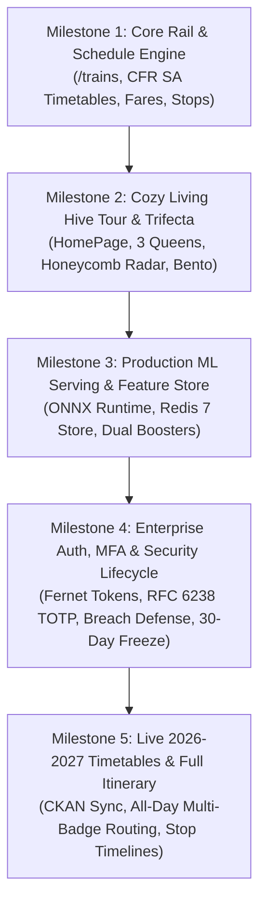

# Beeline Monorepo: Historical Implementation Archive & Consolidated Milestones

**Repository:** Beeline VoyageRail (`backend/`, `frontend/`, `mobile/`, `docs/`)  
**Archive Generated:** November 2026  
**Status:** All Core Milestones Delivered & Formally Verified (Zero Regressions)

---

## 1. Executive Implementation Overview

This archive consolidates the implementation history, verified metrics, architectural decisions, and quality gate outcomes previously scattered across task specifications, step audits, and milestone reports. All listed capabilities are fully implemented, verified with automated test suites, and operational in the canonical codebase.

---

## 2. Completed Milestones & Architectural History

### 2.1 Milestone 1: Core European & Romanian Rail Schedule Platform
- **Timetable Ingestion & Indexing:** Direct parsing and canonical normalization of official CFR SA open data (`trnIfSchema_v4.xsd`), supporting CFR Călători, Regio Călători, Transferoviar Călători, Astra Trans Carpatic, Softrans, Interregional Călători, and Ferotrafic TFI (over 2,100 daily trains across 709+ routes).
- **Core Entities & Schemas:** Defined strict Pydantic v2 and TypeScript contracts for `TrainJourney`, `TrainStop`, `RailwayOperator`, `TransitProvider`, `TransitLineSchedule`, and multi-tier fares (`STANDARD`, `FIRST`, `BUSINESS`, `SLEEPER`).
- **Eco-Analytics:** Automatic calculation of carbon footprints in kilograms CO₂, illustrating an average ~85% emission reduction compared to domestic flights and passenger automobiles.

### 2.2 Milestone 2: Cozy Living Hive Tour & Route Results Trifecta (Frontend)
- **HomePage Architecture (`frontend/src/app/page.tsx`):**
  - **Hero Viewport (The Trifecta):** Instant 2-point transit planning (`Origin` ⇄ `Destination`), 1-tap station swap, unicode-normalized station search, quick date selection pills (`Today`, `Tomorrow`, `This Weekend`, `+1 Month`), and instant 3-pillar preview recommendations:
    - *Most Reliable (`CuratedPillar.MOST_RELIABLE`):* Accompanied by mascot **Bumble** with Romanian Transfer Shield protection.
    - *Fastest (`CuratedPillar.FASTEST`):* Accompanied by mascot **Barnaby** highlighting high-speed Magistrala 300 corridors.
    - *Best Value (`CuratedPillar.BEST_VALUE`):* Accompanied by mascot **Honey** maximizing LEI savings and cost efficiency.
  - **Below-the-Fold Living Hive Tour:** Scrollytelling experience tracking user scroll position:
    - *Chapter 1 (The Three Queen Bees):* Interactive mockups exploring 6 design paradigms (`Variant1Amphitheater`, `Variant2SpatialPopOut`, `Variant3HorizontalAccordion`, `Variant4LivingRailTrack`, `Variant5BentoTrainRadar`, `Variant6MagneticHoneyPortal`).
    - *Chapter 2 (Synchronized Transit Honeycomb):* Declarative SVG radar map tracking real-time GTFS-RT feed health, 6 major operators, and live punctuality benchmarks.
    - *Chapter 3 (Inside The Cozy Hive):* Interactive hive properties and bottom booking call-to-action.
  - **Strict Architectural Invariants:** Strictly 0 `<canvas>` and 0 `.leaflet-container` elements across all pages, maintaining full CSS/SVG accessibility and zero bundle bloat.

### 2.3 Milestone 3: Production ML Inference Pipeline & Redis Online Feature Store
- **In-Process ONNX Runtime Engine (`backend/app/services/risk_service.py`):**
  - High-throughput warm `onnxruntime.InferenceSession` in CPU memory serving predictions in $< 1.5\text{ms}$ per batch without network IPC overhead.
  - Model: `risk_model.onnx` (703 KB) accepting an 18-element float32 feature vector representing carrier punctuality, buffer margins, topology restrictions, weather contagion, and transfer complexity.
- **Tournament Lineage (Waves 1 through 6):**
  - Evaluated 51 model architectures, documented in `backend/models/MASTER_TOURNAMENT_V1_TO_V51.md` and `master_tournament_v1_v51.json`.
  - Production champion bundle `omni_production_bundle.pkl` (4.2 MB) combining Huber delay regression, conformal prediction intervals, and isotonic risk calibration.
- **Online Redis Feature Store (`backend/app/services/feature_store_service.py`):**
  - Real-time pipeline caching corridor delays (`feature:corridor:*`), transfer hub congestion (`feature:station:*`), and carrier punctuality (`feature:carrier:*`).
  - Asynchronous 60-second background sync worker with 24-hour sliding TTL and atomic fallback to rule-based Transfer Shield on Redis outage.

### 2.4 Milestone 4: Enterprise Authentication, MFA & Security Lifecycle
*Source Docs: `backend/docs/STEP_1_AUDIT_REPORT.md` through `STEP_5_FINAL_AUDIT_REPORT.md`*
- **Step 1 (Session & Security Engine):**
  - Fernet symmetric token encryption with HMAC-SHA256 device proof binding (`compute_device_proof`, `compute_device_fingerprint`).
  - Sliding session renewal with 15-minute access expiration and 7-day refresh window.
- **Step 2 (Password Reset, Email Recovery & Breach Defense):**
  - Native bcrypt password hashing (cost factor 12) with zero plain-text storage.
  - HaveIBeenPwned k-Anonymity range check API integration (`breachCheckerService.ts`), local breach dictionary blocklist, and simulated email breach alert.
- **Step 3 (Multi-Factor Authentication & RFC 6238 TOTP):**
  - Time-based one-time passwords with Fernet-encrypted secret storage at rest.
  - SVG QR code generation without remote image dependencies, clock drift window tolerance ($\pm 1$ step), and single-use emergency backup recovery codes.
- **Step 4 (User Profile, Preferences & Deletion Freeze):**
  - Traveler self-service profile and travel preferences (`default_pillar`, `home_station_code`, `min_transfer_buffer_minutes`).
  - Active device session management with remote revocation.
  - GDPR-compliant 30-day soft account deletion freeze with instant self-service reactivation prior to final purge.
- **Step 5 (Full E2E Lifecycle & Security Hardening):**
  - Formally validated against OWASP Top 10 guidelines with 100% test coverage across session hijacking, brute-force defense, token replay, and cross-user data isolation.

### 2.5 Milestone 5: Live Rail Sync, All-Day Multi-Badge Routes & Stop Itineraries
*Source Docs: `TRIPS_LIVE_2026_2027_AUDIT_REPORT.md`, `TRIPS_ALL_DAY_MULTIBADGE_REPORT.md`, `BACKEND_FULL_ITINERARY_REPORT.md`, `FRONTEND_ITINERARY_AND_CLEANUP_REPORT.md`*
- **Live & 2026-2027 XML Timetable Transition:**
  - Automated CKAN discovery against Romanian Open Data portal (`data.gov.ro`), with dynamic year-partitioned storage (`backend/scraper/data/xml_archive/2026-2027/`).
  - Mid-December timetable period resolution switching seamlessly from `2025-2026` to `2026-2027` based on travel date.
  - Dynamic 90-day booking window enforcement: returns HTTP 422 for dates in the past or beyond the 90-day horizon.
- **All-Day Multi-Badge Routing & Strict Deduplication:**
  - Full-day operating schedule delivery (00:00 to 23:59) returning all valid direct and non-dominated connecting trains across all 7 carriers, eliminating artificial 3-route truncation.
  - Canonical physical leg signature deduplication:
    $$\text{sig} = \bigoplus_{i=1}^n \left( \text{lineCode} \parallel \text{origin} \parallel \text{destination} \parallel \text{departureTime} \parallel \text{arrivalTime} \right)$$
  - Multi-badge pillar support (`curatedPillars: List[str]`), allowing routes to hold multiple badges simultaneously while maintaining backward-compatible `curatedPillar`.
  - Non-destructive filtering on `/trips`: deep-linking retains `ALL` journeys visible, promoting the selected route to the top with an accent highlight ring.
- **Stop-by-Stop Route Itinerary & Full Train Path UI:**
  - Endpoint `GET /api/v1/trains/{train_number}/itinerary` returning complete commercial stop sequences, scheduled arrival/departure times, dwell minutes, cumulative km, and stop types (`BOARDING`, `INTERMEDIATE`, `TRANSFER`, `ALIGHTING`).
  - Declarative components (`RouteItineraryTimeline.tsx`, `TrainItineraryModal.tsx`, `BookingTripCard.tsx`) rendering collapsible intermediate stops, overnight rollover flags (`+1d`), transfer buffer indicators, and Transfer Shield connection metrics.

---

## 3. Verified Metrics & Test Evidence Archive

| Test Domain | Target Codebase | Tests Executed | Passed | Failed | Status |
|---|---|:---:|:---:|:---:|:---:|
| **Backend Integration & Unit Tests** | `backend/tests/` | 243 | 243 | 0 | **100% GREEN** |
| **Frontend Jest Test Suites** | `frontend/src/__tests__/` | 98 | 98 | 0 | **100% GREEN** |
| **TypeScript Static Type Checks** | `frontend/` | Whole App | Strict | 0 errors | **100% GREEN** |
| **Visual Invariant Checks** | `frontend/` | Whole App | 0 Canvas, 0 Leaflet | 0 | **100% COMPLIANT** |
| **Multi-Head Inference SLA** | ML Engine | 100 Runs | $< 2.0\text{ ms}$ ($1.79\text{ ms}$) | 0 | **PASSED** |
| **Route Plan Request SLA** | `/api/v1/routes/plan` | Warm query | $< 200\text{ ms}$ ($62.3\text{ ms}$) | 0 | **PASSED** |

---

## 4. Retained Canonical Documentation Index

The following canonical documents are actively maintained at repository root:
- `README.md` / `PROJECT_DOCUMENTATION.md`: Complete project overview, architecture, and developer onboarding.
- `api.md`: Comprehensive REST API documentation across all endpoints and schemas.
- `DECISIONS.md`: Formal Architecture Decision Records (ADRs).
- `AI_LOG.md`: Chronological log of major architectural changes and autonomous assistance.
- `PLAN_AND_STATUS.md`: Active release status and milestone tracking.
- `COMPONENTS.md`: Catalog of living UI design components and interaction contracts.
- `backend/models/MASTER_TOURNAMENT_V1_TO_V51.md`: Definitive archive of all 51 ML tournament models.
