# Beeline HomePage (`/`) Architecture & Technical Specification

> **Status:** 100% Code-Verified against Current Source  
> **Route:** `/`  
> **Entry Point File:** [`frontend/src/app/page.tsx`](file:///Users/iordacheandrei/Desktop/PROIECT%20BD2/frontend/src/app/page.tsx#L1-L846)  
> **Framework & Runtime Stack:** Next.js `16.4.6` (App Router), React `19.3.0`, React-DOM `19.3.0`, Tailwind CSS `^4.0` (via `@tailwindcss/turbopack` and `tailwindcss`), Lucide React `^1.16.0`  
> **Test Suite Status:** 21 Active Jest/React Testing Library Tests in [`frontend/src/__tests__/homePage.test.tsx`](file:///Users/iordacheandrei/Desktop/PROIECT%20BD2/frontend/src/__tests__/homePage.test.tsx#L1-L727) — **21 Passing, 0 Failing (100% Pass Rate)**  
> **Strict Architecture Invariants:**
> - **Strict Invariant 1 (Zero Map / Canvas Elements):** Exactly 0 `<canvas>`, 0 `.leaflet-container`, 0 `<map>` elements across the entire page. All geographic concepts are represented as stylized SVG honeycombs, beehive stations, and topological vector arcs.
> - **Strict Invariant 2 (Zero Raw Technical / Data-Science Jargon in Public DOM):** Strictly zero raw file extensions (`.parquet`, `.xml`), machine learning training jargon (`Out-of-Fold`, `Corpus`), or internal pipeline terms exposed to consumers in visible text.
> - **Strict Invariant 3 (100% Train-Only Transit Scope):** Strictly zero urban local transit operators (`Metrorex`, `STB`, `Transurb`, `CTP Cluj`). The platform exclusively plans and synchronizes intercity and regional passenger railway corridors across Romania.

---

## 1. Executive Summary & Dual-Zone Architecture

The Beeline HomePage (`/`) delivers an ultra-fast, visually cozy, and mathematically rigorous passenger railway portal for Romania. Instead of confronting travelers with confusing station search widgets or archaic timetable tables, HomePage employs a **Dual-Zone Architecture** separating immediate traveler booking from rich scrollytelling platform education:

```
+---------------------------------------------------------------------------------------+
|  ZONE 1: ABOVE-THE-FOLD SCREEN-SIZE HERO (min-h-[calc(100dvh-4rem)])                   |
|  - Ambient Flying Mascot: Clamped mouse-follow (max 64px / 4rem) in fixed backdrop    |
|  - App Branding: "Beeline" H1 + Disruptive Value Proposition ("Romanian Transit is    |
|    Chaotic. We Made It Effortless.")                                                  |
|  - State 1: Instant Search Form (Station Autocomplete + Swap + CFR SA 90-Day Booking   |
|    Window Date Picker + 4 Quick Pills: Today, Tomorrow, Weekend, +1 Month)            |
|  - State 2: Route Trifecta Selector (Safe [Queen Meli], Fast [Queen Vira], Economy    |
|    [Queen Flora]) with ML Expected Delay, Connection Guarantee %, and Price LEI       |
|  - Deep-Linking CTA: Direct redirect to /trips with sanitized corridor & pillar query  |
+---------------------------------------------------------------------------------------+
|  ZONE 2: BELOW-THE-FOLD "THE LIVING HIVE TOUR" (60fps Passive Scrollytelling)         |
|  - Golden Dotted Vector Flight Trail spanning 2400px of vertical travel               |
|  - Chapter 1: The Three Queen Bees & Hive Swarms (Royal Sanctuaries + Interactive     |
|    Beehive Route Preview Map with 7 Beehive Stations & Unified Bee Locomotive)         |
|  - Chapter 2: The Synchronized Transit Honeycomb (Scoreboard: 1,521,651 Runs, 2,103    |
|    Daily Trains, 709 Routes; 2-Way Lens Switcher; 7 Rail Operators + 2 Major Hubs)    |
|  - Chapter 3: Inside The Cozy Hive (Physical Props: Honey Pot, Honey Spoon, Beehive;   |
|    ML Telemetry: 1.52M Runs, <1.5ms Inference, 99.5% Transfer AUC; Jump Back to Hero) |
|  - Floating Travel Companion Guide (ScrollCompanionMascot with dynamic chapter quotes) |
+---------------------------------------------------------------------------------------+
```

### Zone 1: Above-the-Fold Screen-Size Hero
- **Container Sizing:** `min-h-[calc(100dvh-4rem)]` taking full dynamic viewport height minus the 64px (4rem) sticky navigation bar.
- **Immediate Utility:** Travelers can execute a departure-arrival search in under 5 seconds using weekly diacritic-insensitive cached station autocomplete.
- **Provider Date Constraints:** Validated 90-day booking window matching CFR SA / IRIS official timetable scheduling (`min={todayStr}`, `max={maxDateStr}`).
- **Route Trifecta:** Displays 3 distinct travel archetypes computed algorithmically via [`selectTrifectaPlans`](file:///Users/iordacheandrei/Desktop/PROIECT%20BD2/frontend/src/services/tripBookingService.ts#L1782-L1807):
  1. **SAFE ROUTE (`safe`):** Transfer Shield, maximum buffer minutes, highest connection guarantee percentage.
  2. **FAST ROUTE (`fast`):** Express Scout, shortest total duration, direct mainline InterCity corridors, zero stopovers.
  3. **ECONOMY ROUTE (`economy`):** Nectar Saver, lowest ticket fare in Romanian LEI across multi-operator combinations.
- **Deep-Link Handoff:** Clicking `"Book [PILLAR] Route in Trip Planner"` triggers a push navigation to `/trips?origin=...&destination=...&pillar=...&date=...`.

### Zone 2: Below-the-Fold "The Living Hive Tour"
- **Passive 60fps Scrollytelling Engine:** Governed by [`useScrollHiveTour`](file:///Users/iordacheandrei/Desktop/PROIECT%20BD2/frontend/src/components/hive-tour/useScrollHiveTour.ts#L12-L148) with zero scroll jank, RAF throttling, and native `prefers-reduced-motion` compliance.
- **Chapter 1 (`#tour-queens`):** The Three Queen Bees (Queen Meli, Queen Vira, Queen Flora) with 3 top hexagonal sanctuaries, "Open Portal" navigation buttons, and an interactive 7-station vector Beehive Route Preview Map featuring an animated Queen-colored Bee Locomotive and a delay stress-test simulator (+15m unexpected delay absorbed).
- **Chapter 2 (`#tour-providers`):** The Synchronized Transit Honeycomb with a live scoreboard (1,521,651 real journeys, 2,103 daily active trains, 709 connected routes), a 2-way metric lens toggle, and interactive SVG hex cells for 7 Romanian passenger train operators (CFR Călători, TFC, Regio Călători, Interregional Călători, Astra Trans Carpatic, Ferotrafic TFI, Softrans) and 2 strategic rail hubs (București Nord and Carpathian & Danube Hubs).
- **Chapter 3 (`#tour-ecosystem`):** Inside The Cozy Hive featuring three physical SVG props (`HoneyPotSvg`, `HoneySpoonSvg`, `BeehiveSvg`) mapping to ML risk buffering, sub-millisecond edge calibration, and algorithmic junction transfer shields, capped by the `"Ready to Fly? Plan Your Route Now"` jump-back CTA button.
- **Floating Scroll Companion (`ScrollCompanionMascot`):** An accessible floating guide positioned at `fixed bottom-6 right-4 sm:bottom-8 sm:right-8 z-30` that delivers contextual speech bubble guidance tailored to the active chapter and current mascot gear.

---

## 2. Complete Component Tree & File Dependency Matrix

### 2.1 Current Production JSX Tree
The diagram below reflects the exact JSX hierarchy rendered when visiting `/` inside [`RootLayout`](file:///Users/iordacheandrei/Desktop/PROIECT%20BD2/frontend/src/app/layout.tsx#L10-L21) and [`Providers`](file:///Users/iordacheandrei/Desktop/PROIECT%20BD2/frontend/src/app/providers.tsx#L10-L23):

```mermaid
flowchart TD
  RootLayout["RootLayout (frontend/src/app/layout.tsx)"] --> Providers["Providers (frontend/src/app/providers.tsx)"]
  Providers --> ThemeProvider["ThemeProvider"]
  ThemeProvider --> AuthProvider["AuthProvider"]
  AuthProvider --> TripProvider["TripProvider"]
  TripProvider --> CozyHoneyBackground["CozyHoneyBackground (frontend/src/components/CozyHoneyBackground.tsx)"]
  
  CozyHoneyBackground --> Navbar["Navbar (frontend/src/components/Navbar.tsx)"]
  CozyHoneyBackground --> MainTag["main.min-h-[calc(100vh-4rem)]"]
  MainTag --> HomePage["HomePage (frontend/src/app/page.tsx)"]

  %% HomePage Internal Children
  HomePage --> BackgroundBee["BackgroundBee (frontend/src/app/page.tsx)"]
  BackgroundBee --> MascotBeeBg["MascotBee (gear={effectiveGear}, size='4xl')"]

  HomePage --> HeroSection["section#section-hero (Zone 1: Screen-Size Hero)"]
  HeroSection --> HeroH1["h1 'Beeline'"]
  HeroSection --> HeroH2["h2 'Romanian Transit is Chaotic. We Made It Effortless.'"]
  HeroSection --> HeroDesc["p 'Stop gambling on delayed CFR trains...'"]
  
  HeroSection --> CardContainer{"hasSearched State?"}
  
  CardContainer -- "false (Initial Search)" --> SearchCard["BaseCard (Form State 1)"]
  SearchCard --> FormTag["form (onSubmit={handleSearch})"]
  FormTag --> OriginAutocomplete["StationAutocompleteInput#hero-origin-input (Origin)"]
  FormTag --> SwapButton["button (Swap Origin/Destination)"]
  FormTag --> DestAutocomplete["StationAutocompleteInput#hero-destination-input (Destination)"]
  FormTag --> DatePickerRow["Travel Date Input + 4 Quick Pills (Today, Tomorrow, Weekend, +1 Month)"]
  FormTag --> PopularCorridors["Popular Romanian Corridors (București-Brașov, Galați-București, Cluj-Timișoara)"]
  FormTag --> SearchSubmitBtn["BaseButton 'Find Synchronized Routes'"]

  CardContainer -- "true (Results Available)" --> TrifectaCard["BaseCard (Route Trifecta State 2)"]
  TrifectaCard --> ResetSearchBtn["button 'Modify' (handleResetSearch)"]
  TrifectaCard --> SafeRouteCard["div.cursor-pointer (SAFE ROUTE • Transfer Shield)"]
  TrifectaCard --> FastRouteCard["div.cursor-pointer (FAST ROUTE • Express Scout)"]
  TrifectaCard --> EconomyRouteCard["div.cursor-pointer (ECONOMY • Nectar Saver)"]
  TrifectaCard --> BookRouteCTA["BaseButton 'Book [PILLAR] Route in Trip Planner' (data-testid='book-selected-route-cta')"]

  HomePage --> TourWrapper["div.relative.w-full (Zone 2: 'The Living Hive Tour')"]
  TourWrapper --> FlightTrailSvg["svg.tourFlightTrailGrad (Curved Golden Dotted Trail)"]
  TourWrapper --> QueenBeesSection["QueenBeesSection#tour-queens (Chapter 1)"]
  QueenBeesSection --> QueenHexSanctuaries["3 Queen Hexagonal Sanctuaries (Queen Meli, Queen Vira, Queen Flora)"]
  QueenHexSanctuaries --> MiniWorkerBees["MiniWorkerBee (Orbiting Swarm)"]
  QueenHexSanctuaries --> RoyalCrownSvg["RoyalCrownSvg"]
  QueenHexSanctuaries --> OpenPortalBtns["Open Portal Buttons (open-portal-safe, fast, economy)"]
  QueenBeesSection --> RoutePreviewMap["div#queen-route-preview (Single Unified Route Preview)"]
  RoutePreviewMap --> BeehiveStations["7x Beehive Stations (preview-beehive-station)"]
  RoutePreviewMap --> BeeLocomotive["g[data-testid='route-preview-bee-locomotive'][data-bee-color]"]
  RoutePreviewMap --> DelayStressBtn["button[data-testid='safe-delay-btn'] (Delay Stress Simulator)"]

  TourWrapper --> TransitHoneycombSection["TransitHoneycombSection#tour-providers (Chapter 2)"]
  TransitHoneycombSection --> Scoreboard["Live Scoreboard (1,521,651 Runs, 2,103 Daily Trains, 709 Routes)"]
  TransitHoneycombSection --> LensToggle["button[data-testid='honeycomb-metric-toggle'] (2-Way Lens Switcher)"]
  TransitHoneycombSection --> HoneycombCluster["div[data-testid='svg-honeycomb'] (9 Hex Cells: 7 Operators + 2 Hubs)"]
  HoneycombCluster --> HoneycombHexCell["HoneycombHexCell (CFR Hero, TFC, Regio, IRC, Astra, Ferotrafic, Softrans, Hubs)"]
  TransitHoneycombSection --> StoryCard["div[data-testid='provider-story-card'] (Playful Floating Honey Story Card)"]

  TourWrapper --> CozyHiveSection["CozyHiveSection#tour-ecosystem (Chapter 3)"]
  CozyHiveSection --> HoneyPotCard["BaseCard (HoneyPotSvg • ML Risk Engine 1.52M Runs)"]
  CozyHiveSection --> HoneySpoonCard["BaseCard (HoneySpoonSvg • Edge Inference <1.5ms)"]
  CozyHiveSection --> BeehiveCard["BaseCard (BeehiveSvg • Disruption Shield 99.5% AUC)"]
  CozyHiveSection --> JumpBackCTA["BaseButton 'Ready to Fly? Plan Your Route Now'"]

  HomePage --> ScrollCompanionMascot["ScrollCompanionMascot (data-testid='scroll-companion-guide')"]
  ScrollCompanionMascot --> CompanionSpeech["Speech Bubble (aria-live='polite')"]
  ScrollCompanionMascot --> CompanionBee["MascotBee (gear={effectiveGear}, size='lg')"]

  HomePage --> DebugToolsTrigger["button[aria-label='Open Debug Tools'] (Fixed Bottom-Right)"]
  HomePage --> MascotDebugModal["MascotDebugModal (Testing & Debug Tools Panel)"]
```



---

### 2.2 File Dependency Matrix

| File Path | Line Range | Exported Symbols | Primary Props / Types | Key Responsibilities |
| :--- | :--- | :--- | :--- | :--- |
| [`frontend/src/app/page.tsx`](file:///Users/iordacheandrei/Desktop/PROIECT%20BD2/frontend/src/app/page.tsx#L1-L846) | `L1-L846` | `default HomePage`, `BackgroundBee`, `POPULAR_CORRIDORS`, `MAX_BEE_DISPLACEMENT_PX`, `MAX_BEE_DISPLACEMENT_REM`, `BackgroundBeeProps` | `BackgroundBeeProps`: `{ gear: MascotGear }` | Entry route for `/`. Manages search state, date range derivation, trifecta selection, effective gear routing, deep linking to `/trips`, and assembles Zone 1 and Zone 2. |
| [`frontend/src/app/layout.tsx`](file:///Users/iordacheandrei/Desktop/PROIECT%20BD2/frontend/src/app/layout.tsx#L1-L22) | `L1-L22` | `default RootLayout`, `metadata` | `{ children: React.ReactNode }` | Root HTML shell (`lang="ro"`), global CSS stylesheet inclusion, selection highlight styling, and wrapping children in `<Providers>`. |
| [`frontend/src/app/providers.tsx`](file:///Users/iordacheandrei/Desktop/PROIECT%20BD2/frontend/src/app/providers.tsx#L1-L25) | `L1-L25` | `default Providers`, `Providers` | `{ children: React.ReactNode }` | Context stack: `ThemeProvider` → `AuthProvider` → `TripProvider` wrapping `CozyHoneyBackground` containing `Navbar` and `<main>`. |
| [`frontend/src/app/globals.css`](file:///Users/iordacheandrei/Desktop/PROIECT%20BD2/frontend/src/app/globals.css#L1-L612) | `L1-L612` | CSS custom properties, `@keyframes`, utility classes | N/A (CSS) | Core design system tokens (`--honey-*`), 23 custom `@keyframes` animations, reduced-motion overrides, honey shimmer cards, and corridor pills. |
| [`frontend/src/components/CozyHoneyBackground.tsx`](file:///Users/iordacheandrei/Desktop/PROIECT%20BD2/frontend/src/components/CozyHoneyBackground.tsx#L1-L445) | `L1-L445` | `default CozyHoneyBackground`, `CozyHoneyBackground`, `CozyHoneyBackgroundProps` | `children?: React.ReactNode`, `showTexture?: boolean`, `showPollen?: boolean`, `className?: string` | Ambient backdrop rendering 5 visual layers: scroll-reactive lighting (Hero, Apiary, Lantern), cursor lantern halo (`--hive-mouse-*`), living wax honeycomb SVG clusters, viaduct horizon silhouette, and 12 dual-depth pollen motes. |
| [`frontend/src/components/MascotBee.tsx`](file:///Users/iordacheandrei/Desktop/PROIECT%20BD2/frontend/src/components/MascotBee.tsx#L1-L982) | `L1-L982` | `default MascotBee`, `MascotBee`, `GEAR_CONFIG`, `PERSONA_CONFIG`, `resolveGear`, `MascotGear`, `MascotName`, `MascotSize`, `MascotBeeProps`, `GearMetadata` | `gear?: MascotGear`, `name?: MascotName`, `size?: MascotSize`, `animated?: boolean`, `showBadge?: boolean`, `showSpeech?: boolean`, `showAccessoryBadge?: boolean` | Central vector character component rendering 4 personas (`Bumbi`, `Queen Meli`, `Queen Vira`, `Queen Flora`) with smooth exit/enter gear animations and shine starburst sweeps. |
| [`frontend/src/components/MascotDebugModal.tsx`](file:///Users/iordacheandrei/Desktop/PROIECT%20BD2/frontend/src/components/MascotDebugModal.tsx#L1-L241) | `L1-L241` | `default MascotDebugModal`, `MascotDebugModal`, `MascotDebugModalProps` | `isOpen: boolean`, `onClose: () => void`, `currentGear: MascotGear`, `onSelectGear: (gear) => void`, `onResetAuto: () => void`, `isManualOverride: boolean` | Accessible testing & QA modal dialog allowing architects and developers to force mascot gear, inspect accessories, verify animations, and toggle manual override modes. |
| [`frontend/src/components/StationAutocompleteInput.tsx`](file:///Users/iordacheandrei/Desktop/PROIECT%20BD2/frontend/src/components/StationAutocompleteInput.tsx#L1-L315) | `L1-L315` | `default StationAutocompleteInput`, `StationAutocompleteInput`, `StationAutocompleteInputProps` | `value: string`, `onChange: (e) => void`, `onSelectStation?: (s) => void`, `placeholder?: string`, `excludeStationName?: string`, `leftIcon?: ReactNode` | Accessible WAI-ARIA Combobox input providing debounced (40ms) station search, diacritic-insensitive matching, daily train count badges, and keyboard navigation. |
| [`frontend/src/services/stationAutocompleteService.ts`](file:///Users/iordacheandrei/Desktop/PROIECT%20BD2/frontend/src/services/stationAutocompleteService.ts#L1-L378) | `L1-L378` | `stationAutocompleteService`, `FALLBACK_STATION_HUBS`, `normalizeRomanianText` | Service Singleton | Manages weekly station catalog synchronization, localStorage caching with `isoWeek` versioning, background catalog refresh, and diacritic-insensitive candidate scoring. |
| [`frontend/src/components/hive-tour/types.ts`](file:///Users/iordacheandrei/Desktop/PROIECT%20BD2/frontend/src/components/hive-tour/types.ts#L1-L33) | `L1-L33` | `HiveTourChapter`, `MiniBeeVariant`, `TransitProviderInfo` | Type Definitions | Domain contracts for the scrollytelling tour chapters (`hero`, `queens`, `providers`, `ecosystem`), mini worker bee variants, and audited railway operator metadata. |
| [`frontend/src/components/hive-tour/useScrollHiveTour.ts`](file:///Users/iordacheandrei/Desktop/PROIECT%20BD2/frontend/src/components/hive-tour/useScrollHiveTour.ts#L1-L148) | `L1-L148` | `useScrollHiveTour`, `UseScrollHiveTourResult` | Hook Return: `scrollY`, `scrollProgress`, `activeChapter`, `isCompanionVisible`, `prefersReducedMotion` | 60fps passive window scroll tracker. Computes normalized scroll progress, evaluates active chapter viewport bounding boxes with JSDOM fallback, and monitors motion preferences. |
| [`frontend/src/components/hive-tour/QueenBeesSection.tsx`](file:///Users/iordacheandrei/Desktop/PROIECT%20BD2/frontend/src/components/hive-tour/QueenBeesSection.tsx#L1-L1136) | `L1-L1136` | `default QueenBeesSection`, `QueenBeesSection`, `QueenBeesSectionProps` | `activeGear?: MascotGear`, `onSelectQueen?: (g) => void`, `onSelectGear?: (g) => void` | Chapter 1 component rendering 3 Royal Hex-Sanctuaries with orbiting mini bees, "Open Portal" action triggers, and the unified Route Preview Map with 7 Beehive stations and bee locomotive. |
| [`frontend/src/components/hive-tour/TransitHoneycombSection.tsx`](file:///Users/iordacheandrei/Desktop/PROIECT%20BD2/frontend/src/components/hive-tour/TransitHoneycombSection.tsx#L1-L940) | `L1-L940` | `default TransitHoneycombSection`, `TransitHoneycombSection`, `PROVIDERS`, `TOTAL_DATASET_RUNS`, `TOTAL_XML_DAILY_TRAINS`, `TOTAL_XML_CORRIDOR_ROUTES`, `MetricLens` | Section Component | Chapter 2 component rendering the Day-in-the-Hive scoreboard, 2-way metric lens toggle, 9-cell organic honeycomb cluster (7 operators + 2 hubs), and interactive traveler story cards. |
| [`frontend/src/components/hive-tour/CozyHiveSection.tsx`](file:///Users/iordacheandrei/Desktop/PROIECT%20BD2/frontend/src/components/hive-tour/CozyHiveSection.tsx#L1-L218) | `L1-L218` | `default CozyHiveSection`, `CozyHiveSection`, `CozyHiveSectionProps` | `onScrollToHero: () => void`, `scrollProgress: number` | Chapter 3 component displaying physical honey props (`HoneyPotSvg`, `HoneySpoonSvg`, `BeehiveSvg`) representing ML telemetry, and the final `"Ready to Fly? Plan Your Route Now"` jump CTA. |
| [`frontend/src/components/hive-tour/ScrollCompanionMascot.tsx`](file:///Users/iordacheandrei/Desktop/PROIECT%20BD2/frontend/src/components/hive-tour/ScrollCompanionMascot.tsx#L1-L123) | `L1-L123` | `default ScrollCompanionMascot`, `ScrollCompanionMascot`, `ScrollCompanionMascotProps` | `activeChapter: HiveTourChapter`, `companionGear: MascotGear`, `isVisible: boolean`, `scrollProgress: number`, `prefersReducedMotion: boolean` | Fixed floating companion guide offering reactive speech bubbles synced to active chapter context, mascot gear, and sinusoidal vertical float displacement. |
| [`frontend/src/components/hive-tour/MiniWorkerBee.tsx`](file:///Users/iordacheandrei/Desktop/PROIECT%20BD2/frontend/src/components/hive-tour/MiniWorkerBee.tsx#L1-L133) | `L1-L133` | `default MiniWorkerBee`, `MiniWorkerBee`, `MiniWorkerBeeProps` | `variant: 'fast' \| 'safe' \| 'economy'`, `size?: number`, `className?: string`, `delayMs?: number` | Lightweight vector worker bee rendering archetype-matched accents (speed streaks for fast, protective halo for safe, golden pollen dot for economy). |
| [`frontend/src/components/hive-tour/HiveSvgProps.tsx`](file:///Users/iordacheandrei/Desktop/PROIECT%20BD2/frontend/src/components/hive-tour/HiveSvgProps.tsx#L1-L389) | `L1-L389` | `RoyalCrownSvg`, `BeehiveSvg`, `HoneyPotSvg`, `HoneySpoonSvg`, `HoneycombSvg` | Component Props | Pure SVG visual prop components providing physical honey jars, dippers with animated dripping nectar, Langstroth beehives, royal crowns, and honeycomb pattern definitions. |
| [`frontend/src/services/tripBookingService.ts`](file:///Users/iordacheandrei/Desktop/PROIECT%20BD2/frontend/src/services/tripBookingService.ts#L1-L1807) | `L60-L120`, `L1782-L1807` | `generateTripsForCorridor`, `selectTrifectaPlans` | `allPlans: TransitRoutePlan[]` | Extracts Safe, Fast, and Economy trifecta route plans based on `curatedPillars` (`MOST_RELIABLE`, `FASTEST`, `BEST_VALUE`) and generates fallback corridor trips. |
| [`frontend/src/services/apiClient.ts`](file:///Users/iordacheandrei/Desktop/PROIECT%20BD2/frontend/src/services/apiClient.ts#L1-L598) | `L342-L365`, `L516-L541` | `apiClient`, `planRoute`, `fetchStationAutocompleteCatalog`, `searchStations` | API Parameters | Handles backend HTTP communication for station catalog retrieval, station query search, and route planning execution against FastAPI backend endpoints. |

---

## 3. React State Machine, Derived State & Handlers (`frontend/src/app/page.tsx`)

### 3.1 Complete React Hooks & State Inventory

All state variables in [`frontend/src/app/page.tsx`](file:///Users/iordacheandrei/Desktop/PROIECT%20BD2/frontend/src/app/page.tsx#L189-L270) are explicitly documented below:

```typescript
// 1. Navigation Hook
const router = useRouter(); // next/navigation

// 2. Search & Input State
const [origin, setOrigin] = useState<string>('Galați');
const [destination, setDestination] = useState<string>('București Nord');
const [error, setError] = useState<string | null>(null);
const [hasSearched, setHasSearched] = useState<boolean>(false);

// 3. Calendar & Date Constraints State
const [todayStr, setTodayStr] = useState<string>('');      // e.g. "2026-11-19" (ISO YYYY-MM-DD)
const [maxDateStr, setMaxDateStr] = useState<string>('');  // today + 90 days (CFR SA Booking Window)
const [travelDate, setTravelDate] = useState<string>('');  // defaults to todayStr
const [quickDates, setQuickDates] = useState<{
  today: string;
  tomorrow: string;
  weekend: string;
  month: string;
}>({ today: '', tomorrow: '', weekend: '', month: '' });

// 4. Mascot & Route Selection State
const [activeGear, setActiveGear] = useState<MascotGear>('default');
const [selectedRouteType, setSelectedRouteType] = useState<'fast' | 'safe' | 'economy'>('safe');
const [queenSectionGear, setQueenSectionGear] = useState<'safe' | 'fast' | 'economy'>('safe');
const [isManualOverride, setIsManualOverride] = useState<boolean>(false);
const [isDebugModalOpen, setIsDebugModalOpen] = useState<boolean>(false);

// 5. Results State
const [searchResults, setSearchResults] = useState<{
  fast?: TransitRoutePlan;
  safe?: TransitRoutePlan;
  economy?: TransitRoutePlan;
}>({});

// 6. Custom Passive Scroll Engine Hook
const { scrollProgress, activeChapter, isCompanionVisible, prefersReducedMotion } = useScrollHiveTour();
```

### 3.2 Effective Gear Resolution Logic
The mascot gear displayed across the page is a **pure derived state** that dynamically resolves without triggering state re-renders:

```typescript
// Lines 260-270 of frontend/src/app/page.tsx
const effectiveGear: MascotGear = isManualOverride
  ? activeGear
  : activeChapter === 'queens'
  ? queenSectionGear
  : activeChapter === 'providers'
  ? 'default'
  : activeChapter === 'ecosystem'
  ? 'economy'
  : hasSearched
  ? selectedRouteType
  : activeGear;
```

**Resolution Priority Hierarchy:**
1. **Manual Override (`isManualOverride === true`):** Forces user's selected gear from `MascotDebugModal`.
2. **Chapter 1 Viewport (`activeChapter === 'queens'`):** Adopts `queenSectionGear` (defaults to `'safe'`).
3. **Chapter 2 Viewport (`activeChapter === 'providers'`):** Reverts to `'default'` (Bumbi the Mainline Explorer).
4. **Chapter 3 Viewport (`activeChapter === 'ecosystem'`):** Uses `'economy'` (Queen Flora tracking Nectar honey pots).
5. **Post-Search State (`hasSearched === true`):** Follows traveler's clicked trifecta card (`selectedRouteType`: `'safe'`, `'fast'`, or `'economy'`).
6. **Initial Hero State (`hasSearched === false`):** Defaults to `'default'`.

---

### 3.3 Date Picker Constraints & Quick Pills Calculation
Initialized via `useEffect` ([`page.tsx#L214-L241`](file:///Users/iordacheandrei/Desktop/PROIECT%20BD2/frontend/src/app/page.tsx#L214-L241)):
- **`todayStr`:** Current date formatted as `YYYY-MM-DD`.
- **`maxDateStr`:** Current date + 90 days (strictly enforces CFR SA / IRIS 90-day booking window).
- **Quick Date Pills:**
  - **Today:** `todayIso`
  - **Tomorrow:** `today + 1 day`
  - **This Weekend:** Upcoming Saturday (`(6 - dayOfWeek + 7) % 7 || 7` days added)
  - **+1 Month:** Current date with month incremented by 1

---

### 3.4 Popular Romanian Corridors Constant
Defined at [`page.tsx#L33-L37`](file:///Users/iordacheandrei/Desktop/PROIECT%20BD2/frontend/src/app/page.tsx#L33-L37):
```typescript
export const POPULAR_CORRIDORS = [
  { origin: 'București Nord', destination: 'Brașov', label: 'București ⇄ Brașov' },
  { origin: 'Galați', destination: 'București Nord', label: 'Galați ⇄ București' },
  { origin: 'Cluj-Napoca', destination: 'Timișoara Nord', label: 'Cluj ⇄ Timișoara' },
];
```

---

### 3.5 Validation Strings & Search Handlers
In [`handleSearch`](file:///Users/iordacheandrei/Desktop/PROIECT%20BD2/frontend/src/app/page.tsx#L278-L305):
- Empty origin check: `"Please provide a departure origin station or city"`
- Empty destination check: `"Please provide an arrival destination station or city"`
- Identical endpoints check: `"Origin and destination cannot be identical"`
- On successful submission:
  - Invokes `generateTripsForCorridor(origin.trim(), destination.trim())`
  - Extracts trifecta via `selectTrifectaPlans(plans)`
  - Sets `hasSearched = true`
  - Resets `selectedRouteType = 'safe'` and `activeGear = 'safe'`

---

### 3.6 Deep-Link URL Contract (`handleBookSelectedRoute`)
Executed when clicking the CTA button ([`page.tsx#L364-L376`](file:///Users/iordacheandrei/Desktop/PROIECT%20BD2/frontend/src/app/page.tsx#L364-L376)):

```typescript
const pillarParam = 
  selectedRouteType === 'fast' ? 'FASTEST' : 
  selectedRouteType === 'safe' ? 'MOST_RELIABLE' : 'BEST_VALUE';

const queryParams = new URLSearchParams({
  origin: origin.trim(),
  destination: destination.trim(),
  pillar: pillarParam,
  date: travelDate,
});
router.push(`/trips?${queryParams.toString()}`);
```
**Example Generated URL:**  
`/trips?origin=Gala%C8%9Bi&destination=Bucure%C8%99ti+Nord&pillar=MOST_RELIABLE&date=2026-11-19`

---

## 4. Backend Integrations & Live Data Contracts Used by HomePage

### 4.1 Weekly Station Autocomplete
- **Endpoint:** `GET /api/v1/stations/autocomplete-catalog`
- **Fallback Endpoint:** `GET /api/v1/stations/search?query=...&limit=10&min_length=1`
- **Client Cache Protocol:**
  - Reads `localStorage.getItem('beeline_stations_weekly_meta')` containing `{ isoWeek, lastSyncedAt, totalStations }`.
  - Reads `localStorage.getItem('beeline_stations_catalog_${isoWeek}')`.
  - If cached catalog exists, it returns immediately and fires a non-blocking background refresh to verify freshness.
  - If offline or backend unreachable, falls back to `FALLBACK_STATION_HUBS` (16 primary Romanian railway stations).
- **Diacritic Normalization ([`stationAutocompleteService.ts#L175-L186`](file:///Users/iordacheandrei/Desktop/PROIECT%20BD2/frontend/src/services/stationAutocompleteService.ts#L175-L186)):**
  - Replaces Romanian diacritics: `ș/Ș/ş/Ş → s`, `ț/Ț/ţ/Ţ → t`, `ă/Ă/â/Â → a`, `î/Î → i`.
  - Applies Unicode `NFKD` decomposition to eliminate combining diacritical marks.
- **Station Ranking Algorithm ([`stationAutocompleteService.ts#L303-L364`](file:///Users/iordacheandrei/Desktop/PROIECT%20BD2/frontend/src/services/stationAutocompleteService.ts#L303-L364)):**
  1. Exact Station Code Match (Score: `100`)
  2. Exact Normalized Name Match (Score: `90`)
  3. Station Name Starts With Query (Score: `80`)
  4. Word In Station Name Starts With Query (Score: `70`)
  5. Substring Match In Name Or Code (Score: `60`)
  - **Tie-Breaker:** Sorted descending by `dailyTrainCount`.

---

### 4.2 Route Planning & Trifecta Selection
- **API Endpoint:** `POST /api/v1/routes/plan`
- **Selection Function:** [`selectTrifectaPlans(allPlans: TransitRoutePlan[])`](file:///Users/iordacheandrei/Desktop/PROIECT%20BD2/frontend/src/services/tripBookingService.ts#L1782-L1807)
  - Scans `curatedPillars` or `curatedPillar` for:
    - `FASTEST` → Assigned to `fast`
    - `MOST_RELIABLE` → Assigned to `safe`
    - `BEST_VALUE` → Assigned to `economy`
- **ML Risk Attributes Displayed on Cards:**
  - `totalDurationMinutes`: Converted to formatted `${hours}h ${minutes}m`.
  - `riskAnalysis.overallRiskScore`: Converted to buffer score `${100 - overallRiskScore}/100 Buffer`.
  - `riskAnalysis.expectedDelayMinutes`: Displayed as `⏱️ +${expectedDelayMinutes}m expected delay` or `✅ On Time`.
  - `riskAnalysis.missedConnectionProbability`: Displayed as `🛡️ ${Math.round((1 - prob) * 100)}% connection guarantee`.
  - `fare.totalAmountLei`: Displayed formatted as `${totalAmountLei.toFixed(2)} LEI`.

---

## 5. Visual Atmosphere, Mascots & Animation Inventory

### 5.1 `CozyHoneyBackground.tsx` (Ambient Visual Backdrop)
Renders inside [`Providers`](file:///Users/iordacheandrei/Desktop/PROIECT%20BD2/frontend/src/app/providers.tsx#L15) with `pointer-events-none fixed inset-0 overflow-hidden z-0 select-none` and `aria-hidden="true"`:

1. **Layer 1: Scroll-Reactive Golden Hour Atmosphere ([`L221-L255`](file:///Users/iordacheandrei/Desktop/PROIECT%20BD2/frontend/src/components/CozyHoneyBackground.tsx#L221-L255)):**
   - **Hero Zone (Top):** Warm Honeycomb Milk (`linear-gradient(180deg, rgba(255, 253, 249, 0.98) 0%, rgba(255, 253, 249, 0.75) 55%, rgba(254, 243, 199, 0.5) 100%)`). Opacity decays smoothly via `Math.max(0, 1 - progress * 1.85)`.
   - **Middle Tour Zone:** Golden Apiary Glow (`#FFFBEB` with dual radial nectar pools). Opacity peaks at 50% scroll: `Math.max(0, 1 - Math.abs(progress - 0.5) * 2.4)`.
   - **Bottom Cozy Hive Zone:** Cozy Lantern Sunset (`#FEF7E6` with warm golden-honey vignette). Opacity scales upward: `Math.max(0, (progress - 0.42) * 1.75)`.
2. **Layer 2: Interactive Lantern Cursor Halo ([`L259-L266`](file:///Users/iordacheandrei/Desktop/PROIECT%20BD2/frontend/src/components/CozyHoneyBackground.tsx#L259-L266)):**
   - Radial illumination tracking cursor coordinates via CSS variables `--hive-mouse-x` and `--hive-mouse-y` (`radial-gradient(650px circle at var(--hive-mouse-x, 50%) var(--hive-mouse-y, 30%), rgba(245, 158, 11, 0.11), rgba(217, 119, 6, 0.04) 45%, transparent 72%)`).
3. **Layer 3: Living Wax Honeycomb Clusters (Pure SVG [`L271-L317`](file:///Users/iordacheandrei/Desktop/PROIECT%20BD2/frontend/src/components/CozyHoneyBackground.tsx#L271-L317)):**
   - 28 decorative wireframe lattice cells across 4 viewport clusters (Top-Left, Top-Right, Mid-Right, Bottom-Left).
   - 8 nectar-filled living cells pulsing with `.animate-honey-cell-breathe` (`7.5s ease-in-out infinite`).
4. **Layer 4: Cozy Apiary & Railway Viaduct Horizon Silhouette ([`L322-L413`](file:///Users/iordacheandrei/Desktop/PROIECT%20BD2/frontend/src/components/CozyHoneyBackground.tsx#L322-L413)):**
   - Distant rolling hills with classic multi-arch Roman viaduct deck (`rect x="440" y="128" width="620" height="9"`).
   - 7 repeating railway arches and passenger transit train silhouette crossing the viaduct with forward headlight beam.
   - 2 tiered wooden Langstroth beehives with warm glowing arched entrances.
5. **Layer 5: Dual-Depth Floating Golden Pollen Motes ([`L418-L436`](file:///Users/iordacheandrei/Desktop/PROIECT%20BD2/frontend/src/components/CozyHoneyBackground.tsx#L418-L436)):**
   - 12 pollen motes divided into Depth 1 (6 crisp background motes, 3px–5px) and Depth 2 (6 blurred foreground motes, 6px–9px with warm amber liquid glow).

---

### 5.2 `BackgroundBee` (Mouse-Follow Dynamic Mascot)
Defined in [`page.tsx#L46-L187`](file:///Users/iordacheandrei/Desktop/PROIECT%20BD2/frontend/src/app/page.tsx#L46-L187):
- **Clamping Constraint:** Strictly clamped to `MAX_BEE_DISPLACEMENT_PX = 64px` (`MAX_BEE_DISPLACEMENT_REM = 4rem`).
- **Proximity Trigger:** Activates when mouse distance is within `proximityRadius = Math.max(center.width, center.height) * 1.25` (~400px). When outside, resets displacement smoothly to 0.
- **Negative-Zero Guard:** Uses `Object.is(val, -0) || Math.abs(val) < 0.001 ? 0 : val` to guarantee DOM attributes never emit `"-0.00"`.
- **Reset Handlers:** Subscribes to `document.mouseleave` and `window.blur` to smoothly glide displacement back to `(0, 0)` when focus is lost.
- **Reduced Motion:** When `prefers-reduced-motion: reduce` is active, mouse-tracking is disabled (`isNear = false`, `displacement = (0, 0)`).
- **Flight Harmonic:** Animates with `.animate-bee-dynamic-flight` (28-second serene sinusoidal cycle).

---

### 5.3 `MascotBee.tsx` & `GEAR_CONFIG`
The mascot characters represent the 4 travel archetypes:

| Gear Key | Character Name | Role Title | Badge Text | Brand Colors (Color / Text / Bg / Border) | Equipment & Visual Accessories |
| :--- | :--- | :--- | :--- | :--- | :--- |
| `default` | **Bumbi** | Mainline Rail Explorer | `🧭 EXPLORER` | `#F59E0B` / `#92400E` / `#FEF3C7` / `#FDE68A` | Brass aviator goggles with sky-blue tinted lenses, leather strap, and red explorer neckerchief. |
| `fast` | **Queen Vira** | Supersonic Express Scout | `⚡ FAST ROUTE` | `#3B82F6` / `#1E40AF` / `#DBEAFE` / `#BFDBFE` | Aerodynamic high-speed blue visor with reflection beam, flapping scarf, and gold lightning bolt emblem. |
| `safe` | **Queen Meli** | Royal Transfer Shield | `🛡️ SAFE ROUTE` | `#10B981` / `#065F46` / `#D1FAE5` / `#A7F3D0` | Golden hexagonal Romanian Transfer Shield with green verified checkmark and protective epaulets. |
| `economy` | **Queen Flora** | Smart Fare Harvester | `💰 BEST VALUE` | `#D97706` / `#78350F` / `#FEF3C7` / `#FDE68A` | Wire-rim bargain spectacles, honey pot jar on hip with dripping nectar and "L" (LEI) coin insignia. |

#### Gear Transition Mechanism
When gear changes dynamically, [`MascotBee.tsx`](file:///Users/iordacheandrei/Desktop/PROIECT%20BD2/frontend/src/components/MascotBee.tsx#L256-L283) executes an 850ms transition:
1. **Old Gear Exit:** Animates via `.animate-gear-radial-exit` (`380ms cubic-bezier(0.2, 0, 0.35, 1) forwards`), scaling from 1.0 to 1.65 with fade-out.
2. **New Gear Entrance:** Animates via `.animate-gear-enter-top` (`460ms cubic-bezier(0.22, 1, 0.36, 1) forwards`), translating from `-42px` with a gentle settle bounce.
3. **Shine & Glint:** Triggered via `data-testid="mascot-gear-shine"` with a diagonal sheen sweep (`.animate-gear-sweep`, 500ms) and starburst sparkle (`.animate-gear-sparkle`, 520ms).

---

## 6. Below-the-Fold Chapters Deep Dive (`components/hive-tour/`)

### 6.1 `useScrollHiveTour.ts`
- **Hook Purpose:** Passive, 60fps window scroll evaluation without scroll hijacking.
- **Scroll Thresholds:**
  - `scrollY < 180`: Active chapter is `'hero'`, companion is hidden.
  - `scrollY >= 180`: Companion guide becomes visible.
  - **With Layout Engine:**
    - `ecosystemEl.top <= winHeight * 0.45` → `'ecosystem'`
    - `providersEl.top <= winHeight * 0.45` → `'providers'`
    - `queensEl.top <= winHeight * 0.7` → `'queens'`
  - **Without Layout Engine (JSDOM Test Fallback):**
    - `scrollY >= 1800` → `'ecosystem'`
    - `scrollY >= 900` → `'providers'`
    - `scrollY >= 180` → `'queens'`

---

### 6.2 Chapter 1: The Three Queen Bees & Their Hive Swarms (`QueenBeesSection.tsx`)
Section ID: `#tour-queens` ([`QueenBeesSection.tsx#L287`](file:///Users/iordacheandrei/Desktop/PROIECT%20BD2/frontend/src/components/hive-tour/QueenBeesSection.tsx#L287)):
- **3 Top Royal Hexagonal Sanctuaries:**
  - `queen-card-safe`: Queen Meli (Transfer Guard, `open-portal-safe`).
  - `queen-card-fast`: Queen Vira (Express Scout, `open-portal-fast`).
  - `queen-card-economy`: Queen Flora (Nectar Saver, `open-portal-economy`).
  - Each card features 5 archetype-matched orbiting mini worker bees (`MiniWorkerBee`).
- **Interactive Route Preview Map (`#queen-route-preview`, `data-testid="queen-route-preview"`):**
  - **Row 1:** Full-width header, consumer headline promise, and scenario switchers:
    - Safe mode delay buttons: `data-testid="safe-delay-btn"` (+15m unexpected delay absorbed) and `data-testid="safe-ontime-btn"`.
  - **Row 2:** Dedicated 1000x260 SVG Route Map:
    - **7 Beehive Stations (`data-testid="preview-beehive-station"`):**
      1. `Point A • Origin Hive` (Departure Hub)
      2. `Meadow Vale Hive` (Stop 1)
      3. `Sunny Creek Hive` (Stop 2)
      4. `Central Junction Hive` (Main Transfer Hive with `data-testid="emerald-delay-shield"`)
      5. `Amber Ridge Hive` (Stop 4)
      6. `Orchard Valley Hive` (Stop 5)
      7. `Point B • Destination Hive` (Arrival Hub)
    - **Unified Queen-Colored Bee Locomotive (`data-testid="route-preview-bee-locomotive"`):**
      - Attribute `data-bee-color` dynamically updates to `'safe'`, `'fast'`, or `'economy'`.
      - Travels along SVG path via `<animateMotion>` (`5.5s` for safe, `2.4s` for fast, `8.5s` for economy).
      - Fast mode dims the 5 intermediate hives (opacity 0.32, grayscale) with banner `"5 Intermediate Stops Bypassed • 0 Wasted Time • Skipped • 0 Wasted Stops"`.
      - Economy mode displays relaxed pause pills above intermediate hives (`"☕ +12m Relaxed Stop"`, `"🌿 +15m Scenic Break"`).
  - **Row 3:** Full-width outcome banner affirming 100% On-Time Guarantee, Fastest Arrival, or Maximum Pocket Savings.

---

### 6.3 Chapter 2: The Synchronized Transit Honeycomb (`TransitHoneycombSection.tsx`)
Section ID: `#tour-providers` ([`TransitHoneycombSection.tsx#L372`](file:///Users/iordacheandrei/Desktop/PROIECT%20BD2/frontend/src/components/hive-tour/TransitHoneycombSection.tsx#L372)):
- **Live Day-in-the-Hive Scoreboard:**
  - **Daily Active Trains:** `2,103`
  - **Direct & Connected Routes:** `709`
  - **Trips Learned by Our Bees:** `1,521,651`
- **2-Way Metric Lens Switcher (`data-testid="honeycomb-metric-toggle"`):**
  - Button 1: `"🚆 Daily Trains & Routes"` (`activeLens === 'daily_trains'`)
  - Button 2: `"🍯 Trips Learned by Our Bees"` (`activeLens === 'trips_learned'`)
- **Verified Operator Dataset Inventory:**

| Operator ID | Operator Name | Daily Active Trains | Connected Routes | Training Runs Learned | Dataset Share | Primary Corridor Coverage |
| :--- | :--- | :--- | :--- | :--- | :--- | :--- |
| `cfr` | **CFR Călători** (Flagship Hero) | **1,256** | **479** | **985,705** | 64.78% | 100% Nationwide Network (All 8 National Magistrales) |
| `tfc` | **Transferoviar Călători** | **303** | **62** | **176,053** | 11.57% | București, Buzău, Galați, Cluj lines |
| `regio` | **Regio Călători** | **273** | **81** | **332,514** | 21.85% | Moldavia, Banat & Transylvania regional routes |
| `interregional`| **Interregional Călători** | **216** | **59** | **103,647** | 6.81% | Cluj-Napoca, Oradea, Satu Mare, Baia Mare |
| `astra` | **Astra Trans Carpatic** | **21** | **12** | **15,219** | 1.00% | București – Brașov – Arad – Timișoara / Constanța |
| `ferotrafic` | **Ferotrafic TFI** | **18** | **10** | **Daily Feed** | 0.00% | Regional capital feeder routes |
| `softrans` | **Softrans** | **16** | **6** | **12,160** | 0.80% | Craiova – București Nord – Brașov / Constanța |
| `bucuresti-hub`| **București Nord Hub** | **601** | **75** | **327,609** | 21.53% | Central national terminal connecting 5 magistrales |
| `carpathian-danube-hub` | **Carpathian & Danube Hubs** | **262** | **44** | **125,866** | 8.27% | Prahova Valley pass, Ploiești Sud, Făurei bridge |

- **Playful Floating Story Card (`data-testid="provider-story-card"`):** Displays plain-English narrative, 3 summary pills, popular destinations (e.g. `Bucharest ⇄ Brașov`, `Bucharest ⇄ Buzău`), and bee synchronization features.

---

### 6.4 Chapter 3: Inside The Cozy Hive (`CozyHiveSection.tsx`)
Section ID: `#tour-ecosystem` ([`CozyHiveSection.tsx#L26`](file:///Users/iordacheandrei/Desktop/PROIECT%20BD2/frontend/src/components/hive-tour/CozyHiveSection.tsx#L26)):
- **3 Physical SVG Prop Cards:**
  1. **The Nectar Telemetry Pots (`HoneyPotSvg`, `data-testid="svg-honey-pot"`):** Causal Completed-Arrival Contagion, single-track crossing bottlenecks (Galați–Făurei, Line 300), and 3-point weather stress trained on **1.52M Runs**.
  2. **The Calibrated Nectar Dipper (`HoneySpoonSvg`, `data-testid="svg-honey-spoon"`):** Multi-head quantile gradient ensemble computing Connection Guarantee (%) and Expected Delay (min) in **< 1.5ms Edge Inference** with **0.17% ECE** isotonic calibration error.
  3. **The Junction Transfer Beehive (`BeehiveSvg`, `data-testid="svg-beehive"`):** Algorithmic transfer shield protecting connections across Romania's 8 primary junctions with **99.5% Transfer AUC** (`0.9952` ROC-AUC).
- **Jump Back to Hero CTA Container ([`L183-L213`](file:///Users/iordacheandrei/Desktop/PROIECT%20BD2/frontend/src/components/hive-tour/CozyHiveSection.tsx#L183-L213)):**
  - Card titled `"Ready to Fly Across Romania?"`.
  - Button `"Ready to Fly? Plan Your Route Now"` executes smooth scroll to top (`top: 0`) and focuses the origin input field (`#hero-origin-input`).

---

### 6.5 Floating Travel Companion Guide (`ScrollCompanionMascot.tsx`)
- **DOM Container:** `aside[data-testid="scroll-companion-guide"]` ([`ScrollCompanionMascot.tsx#L67-L120`](file:///Users/iordacheandrei/Desktop/PROIECT%20BD2/frontend/src/components/hive-tour/ScrollCompanionMascot.tsx#L67-L120)).
- **Attributes:** `data-chapter={activeChapter}`, `data-companion-gear={companionGear}`, `aria-label="Interactive Mascot Travel Guide"`.
- **Speech Bubble:** Features `aria-live="polite"` announcing chapter dialogues:
  - **Queens Chapter:**  
    *Queen Meli:* `"Transfer Shield active! 95%+ connection shield protecting your rail transfers at Ploiești & Brașov."`  
    *Queen Vira:* `"Supersonic rail corridors loaded! 0 stopovers prioritized on InterCity trunk lines."`  
    *Queen Flora:* `"Comparing CFR Călători, Regio Călători, TFC, Softrans & Astra for lowest LEI!"`
  - **Providers Chapter:**  
    *Bumbi:* `"The Synchronized Rail Grid: CFR Călători and private rail operators united!"`
  - **Ecosystem Chapter:**  
    *Bumbi:* `"The Cozy Hive: Live ML rail telemetry rerouting train delays in real time!"`
- **Float Physics:** Continuous vertical displacement along viewport edge via `Math.sin(scrollProgress * Math.PI * 4) * 12px` (set to 0 in reduced-motion mode).

---

## 7. Design Tokens, CSS Keyframes (`globals.css`) & Responsive Breakpoints

### 7.1 Palette & Design Tokens
- `--honey-primary`: `#F59E0B` (Amber 500)
- `--honey-primary-hover`: `#D97706` (Amber 600)
- `--honey-bg`: `#FFFDF9` (Honeycomb Milk White)
- `--honey-card`: `#FFFFFF`
- `--honey-border`: `#F3E8D2`
- `--honey-text`: `#1E1B18` (Deep Stone Charcoal)
- `--honey-text-muted`: `#78716C`
- Selection Color: `selection:bg-amber-500 selection:text-stone-950`

---

### 7.2 Custom CSS `@keyframes` Inventory

| Keyframe Name | Duration & Easing | Applied CSS Utility Class | Target Elements & Purpose |
| :--- | :--- | :--- | :--- |
| `floatParticle` | `8s / 11s / 14s ease-in-out infinite` | `.animate-pollen-1`, `.animate-pollen-2`, `.animate-pollen-3` | Ambient pollen motes floating vertically. |
| `mascotFloat` | `3s ease-in-out infinite` | `.animate-mascot-float` | Gentle mascot hover breathing. |
| `wingFlutterLeft` | `0.48s ease-in-out infinite` | `.animate-wing-left` | Vector bee left wing flutter. |
| `wingFlutterRight`| `0.48s ease-in-out infinite` | `.animate-wing-right` | Vector bee right wing flutter. |
| `beeDynamicFlight`| `28s ease-in-out infinite` | `.animate-bee-dynamic-flight` | Serene harmonic flight loop for background hero bee. |
| `honeyCellBreathe`| `7.5s ease-in-out infinite` | `.animate-honey-cell-breathe` | Shimmer pulsation of nectar cells in background SVG. |
| `pollenFloatGentle`| `14s ease-in-out infinite` | `.animate-pollen-gentle` | Calm sinusoidal drift of dual-depth pollen motes. |
| `gearRadialExit` | `380ms cubic-bezier(0.2, 0, 0.35, 1)` | `.animate-gear-radial-exit` | Old mascot gear scaling up and fading out radially. |
| `gearEnterFromTop`| `460ms cubic-bezier(0.22, 1, 0.36, 1)` | `.animate-gear-enter-top` | New mascot gear descending vertically with bounce. |
| `gearRadialShockwave`| `420ms cubic-bezier(0.1, 0.6, 0.3, 1)`| `.animate-gear-shockwave` | Shockwave ring expanding from mascot center. |
| `gearShineSparkle`| `520ms / 480ms cubic-bezier(0.34, 1.56, 0.64, 1)` | `.animate-gear-sparkle`, `-delayed` | Starburst sparkle glints on equipped accessories. |
| `gearShineSweep` | `500ms ease-out 250ms forwards` | `.animate-gear-sweep` | Diagonal sheen beam sweeping across equipped gear. |
| `fadeIn` | `0.25s ease-out forwards` | `.animate-fade-in` | Subtle entrance fade for modal and speech bubble. |
| `miniBeeFast` | `1.4s ease-in-out infinite` | `.animate-mini-bee-fast` | Fast mini worker bee zippy translation. |
| `miniBeeSafe` | `2.8s ease-in-out infinite` | `.animate-mini-bee-safe` | Safe mini worker bee steady rhythmic rotation. |
| `miniBeeEconomy` | `2.2s ease-in-out infinite` | `.animate-mini-bee-economy` | Economy mini worker bee gentle pacing. |
| `trainGlideSafe` | `3.8s ease-in-out infinite` | `.animate-train-glide-safe` | Safe rail route translation glide. |
| `trainGlideFast` | `2.2s cubic-bezier(0.4, 0, 0.2, 1) infinite` | `.animate-train-glide-fast` | High-speed electric express translation glide. |
| `trainGlideEconomy`| `4.4s ease-in-out infinite` | `.animate-train-glide-economy` | Calm scenic rail translation glide. |
| `trackDashFlow` | `1.6s linear infinite` | `.animate-track-flow` | Dashed railway stroke animation along SVG corridors. |
| `corridorTrainGlide`| `10s / 5s / 12s` | `.animate-corridor-train-*` | Panoramic viaduct train pulse. |
| `drizzleNectar` | `2s ease-in-out infinite` | `.animate-drizzle-nectar` | Liquid honey dipper dripping nectar pulse. |

---

### 7.3 Responsive Breakpoints & Layout Behaviors

- **Mobile Viewport (`<640px`):**
  - Station inputs stack vertically (`flex-col`).
  - Swap button displays vertical arrow orientation (`rotate-90`).
  - Trifecta cards stack into a single column (`grid-cols-1`).
  - Scoreboard metrics stack into 3 single-column cards.
  - Organic honeycomb cells scale down to compact widths (`w-36` to `w-44`).
  - Floating companion adopts compact bubble max-width (`max-w-[240px]`).
- **Tablet Viewport (`640px – 1024px`):**
  - Origin and destination inputs align horizontally (`sm:flex-row`).
  - Swap button returns to horizontal orientation (`sm:rotate-0`).
  - Trifecta cards expand to 3 equal columns (`sm:grid-cols-3`).
  - Route preview map expands to 260px height.
  - Honeycomb cluster arranges in 3 distinct rows (`topRow`, `middleRow`, `bottomRow`).
- **Desktop Viewport (`>1024px`):**
  - Full screen-size hero (`min-h-[calc(100dvh-4rem)]`).
  - Background flying mascot expands to full scale (`scale-100`, `opacity-25`).
  - Honeycomb cluster shows ambient background nectar bridge SVG paths.
  - Floating companion positions comfortably at `bottom-8 right-8`.

---

## 8. Strict Invariants, Selector Map & Test Suite Coverage

### 8.1 Complete Selector & Invariant Map

| DOM Selector / Test ID | Element Type | Source File & Line | Asserted in Test Cases | Invariant / Expected State |
| :--- | :--- | :--- | :--- | :--- |
| `role="heading", level=1` | `<h1>` | [`page.tsx#L396`](file:///Users/iordacheandrei/Desktop/PROIECT%20BD2/frontend/src/app/page.tsx#L396) | Test 1 | Must equal `"Beeline"`. |
| `role="heading", level=2` | `<h2>` | [`page.tsx#L401`](file:///Users/iordacheandrei/Desktop/PROIECT%20BD2/frontend/src/app/page.tsx#L401) | Test 1 | Must contain `"Romanian Transit is Chaotic."`. |
| `.leaflet-container, canvas, map` | Leaflet/Canvas | N/A (Forbidden) | Tests 2, 17, 19, 20, 21 | **Strict Invariant 1:** Must return 0 elements in DOM. |
| `[data-testid="background-flying-mascot"]` | `<div>` | [`page.tsx#L151`](file:///Users/iordacheandrei/Desktop/PROIECT%20BD2/frontend/src/app/page.tsx#L151) | Tests 3, 4, 5, 6 | Has `fixed`, `pointer-events-none`, `data-gear`. |
| `[data-testid="bee-mascot-anchor"]` | `<div>` | [`page.tsx#L158`](file:///Users/iordacheandrei/Desktop/PROIECT%20BD2/frontend/src/app/page.tsx#L158) | Tests 7, 8, 9, 10, 11 | Anchor reference for bounding rect coordinates. |
| `[data-testid="bee-mascot-follow"]` | `<div>` | [`page.tsx#L162`](file:///Users/iordacheandrei/Desktop/PROIECT%20BD2/frontend/src/app/page.tsx#L162) | Tests 7, 8, 9, 10, 11 | Has `data-displacement-x`, `data-displacement-y`, `data-near`. Clamped to 64px. |
| `[data-testid="mascot-gear-shine"]` | `<g>` | [`MascotBee.tsx#L588`](file:///Users/iordacheandrei/Desktop/PROIECT%20BD2/frontend/src/components/MascotBee.tsx#L588) | Test 4 | Appears upon dynamic gear change. |
| `role="button", "Debug Tools"` | `<button>` | [`page.tsx#L815`](file:///Users/iordacheandrei/Desktop/PROIECT%20BD2/frontend/src/app/page.tsx#L815) | Test 5 | Trigger for `MascotDebugModal` (`aria-haspopup="dialog"`). |
| `title="Swap Origin and Destination"` | `<button>` | [`page.tsx#L435`](file:///Users/iordacheandrei/Desktop/PROIECT%20BD2/frontend/src/app/page.tsx#L435) | Tests 12, 16 | Swaps origin and destination input values. |
| `role="button", "Find Synchronized Routes"` | `<button>` | [`page.tsx#L566`](file:///Users/iordacheandrei/Desktop/PROIECT%20BD2/frontend/src/app/page.tsx#L566) | Tests 4, 14, 15, 16 | Executes search, transitions to trifecta state. |
| `[data-testid="travel-date-picker"]` | `<input type="date">` | [`page.tsx#L477`](file:///Users/iordacheandrei/Desktop/PROIECT%20BD2/frontend/src/app/page.tsx#L477) | [`page.tsx#L477`](file:///Users/iordacheandrei/Desktop/PROIECT%20BD2/frontend/src/app/page.tsx#L477) | Validates CFR SA 90-day booking window constraints. |
| `[data-testid="book-selected-route-cta"]` | `<button>` | [`page.tsx#L739`](file:///Users/iordacheandrei/Desktop/PROIECT%20BD2/frontend/src/app/page.tsx#L739) | Test 15 | Deep links to `/trips` with corridor & pillar query parameters. |
| `[data-testid="honeycomb-metric-toggle"]` | `<div>` | [`TransitHoneycombSection.tsx#L460`](file:///Users/iordacheandrei/Desktop/PROIECT%20BD2/frontend/src/components/hive-tour/TransitHoneycombSection.tsx#L460) | Test 17 | Toggles `daily_trains` vs `trips_learned`. |
| `[data-testid="svg-honeycomb"]` | `<div>` | [`TransitHoneycombSection.tsx#L498`](file:///Users/iordacheandrei/Desktop/PROIECT%20BD2/frontend/src/components/hive-tour/TransitHoneycombSection.tsx#L498) | Tests 17, 18 | SVG honeycomb cluster rendering all 9 rail cells. |
| `[data-testid="provider-story-card"]` | `<div>` | [`TransitHoneycombSection.tsx#L618`](file:///Users/iordacheandrei/Desktop/PROIECT%20BD2/frontend/src/components/hive-tour/TransitHoneycombSection.tsx#L618) | Test 17 | Story card updated when inspecting rail operators. |
| `[data-testid="queen-card-safe"]` | `<div>` | [`QueenBeesSection.tsx#L322`](file:///Users/iordacheandrei/Desktop/PROIECT%20BD2/frontend/src/components/hive-tour/QueenBeesSection.tsx#L322) | Test 18 | Queen Meli sanctuary card. |
| `[data-testid="queen-card-fast"]` | `<div>` | [`QueenBeesSection.tsx#L322`](file:///Users/iordacheandrei/Desktop/PROIECT%20BD2/frontend/src/components/hive-tour/QueenBeesSection.tsx#L322) | Test 18 | Queen Vira sanctuary card. |
| `[data-testid="queen-card-economy"]` | `<div>` | [`QueenBeesSection.tsx#L322`](file:///Users/iordacheandrei/Desktop/PROIECT%20BD2/frontend/src/components/hive-tour/QueenBeesSection.tsx#L322) | Test 18 | Queen Flora sanctuary card. |
| `[data-mini-bee-variant="fast|safe|economy"]` | `<div>` | [`MiniWorkerBee.tsx#L49`](file:///Users/iordacheandrei/Desktop/PROIECT%20BD2/frontend/src/components/hive-tour/MiniWorkerBee.tsx#L49) | Test 18 | Minimalist archetype-matched mini worker bees. |
| `[data-testid="svg-beehive"]` | `<div>` | [`HiveSvgProps.tsx#L65`](file:///Users/iordacheandrei/Desktop/PROIECT%20BD2/frontend/src/components/hive-tour/HiveSvgProps.tsx#L65) | Tests 18, 20 | Pure SVG Langstroth beehive. |
| `[data-testid="svg-honey-pot"]` | `<div>` | [`HiveSvgProps.tsx#L157`](file:///Users/iordacheandrei/Desktop/PROIECT%20BD2/frontend/src/components/hive-tour/HiveSvgProps.tsx#L157) | Test 18 | Pure SVG Honey Pot with amber nectar level. |
| `[data-testid="svg-honey-spoon"]` | `<div>` | [`HiveSvgProps.tsx#L271`](file:///Users/iordacheandrei/Desktop/PROIECT%20BD2/frontend/src/components/hive-tour/HiveSvgProps.tsx#L271) | Test 18 | Pure SVG Honey Dipper with animated dripping stream. |
| `[data-testid="scroll-companion-guide"]` | `<aside>` | [`ScrollCompanionMascot.tsx#L68`](file:///Users/iordacheandrei/Desktop/PROIECT%20BD2/frontend/src/components/hive-tour/ScrollCompanionMascot.tsx#L68) | Test 19 | Floating companion guide with reactive speech bubbles. |
| `[data-testid="open-portal-safe|fast|economy"]`| `<button>` | [`QueenBeesSection.tsx#L447`](file:///Users/iordacheandrei/Desktop/PROIECT%20BD2/frontend/src/components/hive-tour/QueenBeesSection.tsx#L447) | Test 21 | Open Portal triggers scrolling to `#queen-route-preview`. |
| `[data-testid="queen-route-preview"]` | `<div>` | [`QueenBeesSection.tsx#L474`](file:///Users/iordacheandrei/Desktop/PROIECT%20BD2/frontend/src/components/hive-tour/QueenBeesSection.tsx#L474) | Test 21 | Single unified interactive route preview map. |
| `[data-testid="preview-beehive-station"]` | `<g>` | [`QueenBeesSection.tsx#L892`](file:///Users/iordacheandrei/Desktop/PROIECT%20BD2/frontend/src/components/hive-tour/QueenBeesSection.tsx#L892) | Test 21 | Exactly 7 generic beehive stations along corridor. |
| `[data-testid="route-preview-bee-locomotive"]`| `<g>` | [`QueenBeesSection.tsx#L966`](file:///Users/iordacheandrei/Desktop/PROIECT%20BD2/frontend/src/components/hive-tour/QueenBeesSection.tsx#L966) | Test 21 | Queen-colored Bee Locomotive replacing train icon. |
| `[data-testid="safe-delay-btn"]` | `<button>` | [`QueenBeesSection.tsx#L527`](file:///Users/iordacheandrei/Desktop/PROIECT%20BD2/frontend/src/components/hive-tour/QueenBeesSection.tsx#L527) | Test 21 | Simulates +15m unexpected delay absorbed by buffer. |

---

### 8.2 Test Suite Coverage Inventory (`homePage.test.tsx`)

All 21 active tests in [`frontend/src/__tests__/homePage.test.tsx`](file:///Users/iordacheandrei/Desktop/PROIECT%20BD2/frontend/src/__tests__/homePage.test.tsx#L1-L727) are cataloged below:

1. **Test 1 (`L22-L39`):** Renders clean Beeline H1 and disruptive message without clutter labels (`"Transit Planner"`, `"Romanian Transit Solved"`).
2. **Test 2 (`L41-L46`):** Asserts strictly ZERO map elements (`.leaflet-container`, `canvas`, `map`) across the hero (Strict Invariant 1).
3. **Test 3 (`L48-L63`):** Validates default explorer mascot gear (`data-gear="default"`) and initial input fields with legacy right-hand card completely removed.
4. **Test 4 (`L65-L103`):** Searches corridors, generates trifecta options (Safe, Fast, Economy), dynamically switches mascot gear, verifies entering/exiting CSS classes, and resets back to default via "Modify".
5. **Test 5 (`L105-L154`):** Verifies gear selection is absent from standard UI but fully accessible via discrete "Debug Tools" popup dialog with manual override reset.
6. **Test 6 (`L156-L166`):** Asserts scaled-up background flying bee mascot renders in a non-intrusive `fixed pointer-events-none` container with `aria-hidden="true"`.
7. **Test 7 (`L168-L217`):** Proves mouse-follow smoothly tracks cursor movements near the bee, clamped strictly to `MAX_BEE_DISPLACEMENT_PX` (64px / 4rem).
8. **Test 8 (`L219-L245`):** Smoothly resets displacement to `(0.00, 0.00)` when mouse leaves the browser document.
9. **Test 9 (`L247-L273`):** Resets displacement to `(0.00, 0.00)` when window loses focus (`blur` event).
10. **Test 10 (`L275-L305`):** Accurately clamps negative displacement vectors without producing negative zero strings (`"-0.00"`).
11. **Test 11 (`L307-L343`):** Honors `prefers-reduced-motion: reduce` by ignoring mouse movement tracking.
12. **Test 12 (`L346-L359`):** Swaps origin and destination when clicking the swap button (`Galați ⇄ București Nord`).
13. **Test 13 (`L361-L371`):** Auto-populates origin and destination inputs when clicking popular Romanian corridor pills (e.g. `București ⇄ Brașov`).
14. **Test 14 (`L373-L389`):** Validates empty inputs and identical origin/destination combinations with explicit user error messages.
15. **Test 15 (`L391-L403`):** Navigates to `/trips` with sanitized query parameters when clicking the booking CTA button.
16. **Test 16 (`L405-L428`):** Ensures foreground inputs, buttons, and corridor pills remain fully accessible and interactive.
17. **Test 17 (`L430-L540`):** Asserts Chapter 2 Honeycomb renders all 7 Romanian railway operators and 2 hubs, verifies scoreboard totals (`1,521,651`, `2,103`, `709`), tests 2-way metric lens switcher, tests story card updates, and enforces strict invariants (zero maps, zero raw data science jargon, zero urban transit).
18. **Test 18 (`L542-L581`):** Verifies Chapter 1 Queen Bee cards (`safe`, `fast`, `economy`), archetype-matched Mini Worker Bees, and rich SVG props (`BeehiveSvg`, `HoneyPotSvg`, `HoneySpoonSvg`, `HoneycombSvg`).
19. **Test 19 (`L583-L623`):** Updates scroll companion mascot state across chapters on window scroll, validates speech bubble accessibility (`aria-live="polite"`), and verifies the Jump Back to Hero CTA.
20. **Test 20 (`L625-L643`):** Confirms all 4 named mascots (`Bumbi`, `Queen Meli`, `Queen Vira`, `Queen Flora`) are in the DOM and Chapter 3 displays railway ML telemetry (`1.52M Runs`, `<1.5ms Inference`, `99.5% Transfer AUC`).
21. **Test 21 (`L645-L726`):** Asserts Chapter 1 unified architecture: 3 Top Sanctuaries with "Open Portal" triggers, interactive `#queen-route-preview` map, exactly 7 Beehive Stations (`data-testid="preview-beehive-station"`), Queen-colored Bee Locomotive (`data-testid="route-preview-bee-locomotive"`), and consumer stories for Reliability (+15m delay absorbed test), Fast (-55 minutes saved, 0 wasted stops), and Economy (40% savings, relaxed stops).
