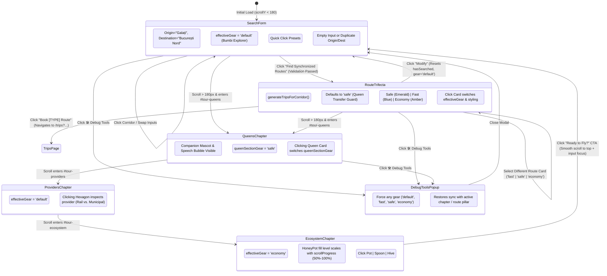

# Beeline HomePage Architecture & Technical Specification

> **Location:** [`frontend/src/app/page.tsx`](file:///Users/iordacheandrei/Desktop/PROIECT%20BD2/frontend/src/app/page.tsx)  
> **Route:** `/` (Web Client Root)  
> **Design Philosophy:** "The Cozy Hive" Screen-Size Hero with Dynamic Mascot Companion & "The Living Hive Tour" 60fps Scrollytelling  
> **Associated Test Suite:** [`frontend/src/__tests__/homePage.test.tsx`](file:///Users/iordacheandrei/Desktop/PROIECT%20BD2/frontend/src/__tests__/homePage.test.tsx) (**19/19 Tests Passing**)  
> **Build Status:** Fully implemented in Next.js 14 App Router (`'use client'`) with zero `<canvas>` / zero map elements

---

## 1. Executive Summary & Core Purpose

The **HomePage** serves as the primary interactive launchpad for **Beeline**, an enterprise-grade transit synchronization platform tailored for Romania's passenger transit network. It unifies intercity rail carriers (**CFR Călători**, **Astra Trans Carpatic**, **Transferoviar Călători**, **Regio Călători**, **Softrans**) with major municipal transit networks (**Metrorex**, **STB București**, **Transurb Galați**, **CTP Cluj-Napoca**).

The page is architected into two seamlessly linked experiential zones:
1. **Above-the-Fold (Screen-Size Hero — Viewport 1):**  
   - Fits comfortably in `min-h-[calc(100dvh-4rem)]` with a centered `max-w-3xl` card container.
   - Provides instantaneous corridor search between Romanian departure and arrival stations with pre-configured corridor shortcuts.
   - Resolves into a **Curated Route Trifecta**: **SAFE ROUTE** (*Transfer Shield*), **FAST ROUTE** (*Express Scout*), and **ECONOMY** (*Nectar Saver*).
   - Features an ambient vector SVG bee mascot (`BackgroundBee`) hovering in the background that smoothly follows cursor movements (clamped to 64px / 4rem) and dynamically shifts equipment and accessories based on the active route selection.
2. **Below-the-Fold ("The Living Hive Tour" — 60fps Scrollytelling):**  
   - A passive scroll-driven tour engine (`useScrollHiveTour`) that tracks viewport scroll progress from `0.0` to `1.0` and coordinates active chapter transitions at 60fps via `requestAnimationFrame`.
   - A decorative, curved golden-dotted SVG flight trail flowing behind the content.
   - **Chapter 1 — The Royal Hives:** Introduces the three Queen Bees (**Queen Transfer Guard / Queen Meli**, **Queen Express Scout / Queen Vira**, **Queen Nectar Saver / Queen Flora**) accompanied by archetype-matched minimalist **Mini Worker Bees**.
   - **Chapter 2 — The Connected Network:** An interactive 9-cell hexagonal Honeycomb Grid presenting 5 intercity rail carriers and 4 municipal transit networks with a live provider inspector chamber.
   - **Chapter 3 — Inside The Cozy Hive:** Physical SVG honey props (**The Honey Pots** with dynamic fill level driven by scroll progress, **The Honey Dipper** drizzling booking data, and **The Central Beehive** disruption rerouting shield) followed by a **Jump-Back-To-Hero CTA** button.
   - **Floating Companion Guide (`ScrollCompanionMascot`):** A fixed bottom-right mascot companion with dynamic contextual speech bubbles reflecting the user's current scroll chapter and active gear.

---

## 2. Architecture & Component Hierarchy

The HomePage is an interactive Client Component (`'use client'`) integrated inside the Next.js App Router root layout and wrapped by global context providers.

### 2.1 Component Tree Diagram

```mermaid
flowchart TD
    RootLayout["RootLayout (frontend/src/app/layout.tsx)"] --> Providers["Providers (frontend/src/app/providers.tsx)"]
    Providers --> ThemeProvider["ThemeProvider (The Cozy Hive)"]
    Providers --> AuthProvider["AuthProvider (Session & MFA)"]
    Providers --> TripProvider["TripProvider (Active Booking State)"]
    Providers --> CozyHoneyBackground["CozyHoneyBackground (Honeycomb Grid & Pollen Motes)"]
    Providers --> Navbar["Navbar (Navigation & Auth Header)"]
    Providers --> HomePage["HomePage (frontend/src/app/page.tsx)"]

    %% VIEWPORT 1: ABOVE THE FOLD
    HomePage --> BackgroundBee["BackgroundBee (Ambient Flying Mascot)"]
    BackgroundBee --> MascotBeeBg["MascotBee (SVG Multi-Gear Vector Bee)"]

    HomePage --> HeroSection["Section: Corridor Search Hero (#section-hero)"]
    HeroSection --> HeroContainer["Hero Container (Centered max-w-3xl)"]
    HeroContainer --> BrandHeader["Beeline Brand & Disruptive Headline"]
    
    HeroContainer --> FormCard["State 1: Search Form (!hasSearched)"]
    FormCard --> BaseInputOrig["BaseInput: Origin (#hero-origin-input)"]
    FormCard --> SwapBtn["Swap Button (ArrowLeftRight rotate-90 sm:rotate-0)"]
    FormCard --> BaseInputDest["BaseInput: Destination"]
    FormCard --> Corridors["Popular Corridors (București, Brașov, Galați, Cluj, Timișoara)"]
    FormCard --> SearchBtn["BaseButton: 'Find Synchronized Routes'"]

    HeroContainer --> TrifectaCard["State 2: Route Trifecta (hasSearched)"]
    TrifectaCard --> CorridorSummary["Corridor Banner & 'Modify' Button"]
    TrifectaCard --> SafeCard["Card: SAFE ROUTE (Transfer Shield - Emerald)"]
    TrifectaCard --> FastCard["Card: FAST ROUTE (Express Scout - Blue)"]
    TrifectaCard --> EconomyCard["Card: ECONOMY (Nectar Saver - Amber)"]
    TrifectaCard --> BookCTA["BaseButton: 'Book [TYPE] Route in Trip Planner'"]

    %% VIEWPORT 2+: THE LIVING HIVE TOUR
    HomePage --> TourContainer["Below-the-Fold Tour Container"]
    TourContainer --> FlightTrailSvg["SVG Curved Dotted Flight Trail (tourFlightTrailGrad)"]
    
    TourContainer --> QueenSection["Chapter 1: QueenBeesSection (#tour-queens)"]
    QueenSection --> RoyalCrown["RoyalCrownSvg (Jeweled Floating Crown)"]
    QueenSection --> QueenCards["3 Royal Queen Hive Cards (Safe, Fast, Economy)"]
    QueenCards --> MiniBees1["MiniWorkerBee Swarms (data-mini-bee-variant)"]

    TourContainer --> HoneycombSection["Chapter 2: TransitHoneycombSection (#tour-providers)"]
    HoneycombSection --> LatticeBg["HoneycombSvg (Decorative Lattice)"]
    HoneycombSection --> HexGrid["9-Cell Interactive Honeycomb Grid"]
    HexGrid --> RailCells["5 Intercity Rail Hexagons (CFR, Astra, TFC, Regio, Softrans)"]
    HexGrid --> TransitCells["4 Municipal Transit Hexagons (Metrorex, STB, Transurb, CTP)"]
    HoneycombSection --> ProviderInspector["Selected Provider Detail Inspector Card"]

    TourContainer --> CozyHive["Chapter 3: CozyHiveSection (#tour-ecosystem)"]
    CozyHive --> PropPots["HoneyPotSvg (Dynamic Scroll Fill Level)"]
    CozyHive --> PropSpoon["HoneySpoonSvg (Drizzling Golden Honey)"]
    CozyHive --> PropHive["BeehiveSvg (Tiered Wooden Central Hive)"]
    CozyHive --> JumpBackCTA["Jump Back to Action CTA Card ('Ready to Fly?')"]

    %% FLOATING COMPANION & DEBUG TOOLS
    HomePage --> CompanionGuide["ScrollCompanionMascot (Fixed Bottom-Right)"]
    CompanionGuide --> SpeechBubble["Companion Speech Bubble (aria-live='polite')"]
    CompanionGuide --> MascotBeeCompanion["MascotBee (Size 'lg', Sine-Wave Float)"]

    HomePage --> DebugTrigger["Debug Tools Trigger Button (Fixed Bottom-Right)"]
    HomePage --> MascotDebugModal["MascotDebugModal (Gear Override Dialog)"]
```



### 2.2 File & Module Dependencies

| Module / Component | Source Path | Role & Specific Implementation Details |
| :--- | :--- | :--- |
| **`HomePage`** | [`frontend/src/app/page.tsx`](file:///Users/iordacheandrei/Desktop/PROIECT%20BD2/frontend/src/app/page.tsx) | Page root component, coordinates search state, derived gear resolution, scroll integration, route redirection. |
| **`BackgroundBee`** | [`frontend/src/app/page.tsx#L40-L185`](file:///Users/iordacheandrei/Desktop/PROIECT%20BD2/frontend/src/app/page.tsx#L40-L185) | Ambient background mascot with cursor proximity tracking (64px clamp), micro-jitter suppression, and safe coordinate formatting. |
| **`useScrollHiveTour`** | [`frontend/src/components/hive-tour/useScrollHiveTour.ts`](file:///Users/iordacheandrei/Desktop/PROIECT%20BD2/frontend/src/components/hive-tour/useScrollHiveTour.ts) | Custom hook managing passive `scroll` listener with `requestAnimationFrame`, progress normalization (`0.0`-`1.0`), and chapter detection. |
| **`QueenBeesSection`** | [`frontend/src/components/hive-tour/QueenBeesSection.tsx`](file:///Users/iordacheandrei/Desktop/PROIECT%20BD2/frontend/src/components/hive-tour/QueenBeesSection.tsx) | Chapter 1 scrollytelling section displaying the 3 Queen Bees, floating royal crowns, and orbiting minimalist mini worker bees. |
| **`TransitHoneycombSection`** | [`frontend/src/components/hive-tour/TransitHoneycombSection.tsx`](file:///Users/iordacheandrei/Desktop/PROIECT%20BD2/frontend/src/components/hive-tour/TransitHoneycombSection.tsx) | Chapter 2 scrollytelling section featuring 9 interlocking hexagonal provider buttons (5 rail, 4 municipal transit) and inspector card. |
| **`CozyHiveSection`** | [`frontend/src/components/hive-tour/CozyHiveSection.tsx`](file:///Users/iordacheandrei/Desktop/PROIECT%20BD2/frontend/src/components/hive-tour/CozyHiveSection.tsx) | Chapter 3 scrollytelling section displaying the 3 interactive honey props and the Jump-Back-To-Hero CTA card. |
| **`ScrollCompanionMascot`** | [`frontend/src/components/hive-tour/ScrollCompanionMascot.tsx`](file:///Users/iordacheandrei/Desktop/PROIECT%20BD2/frontend/src/components/hive-tour/ScrollCompanionMascot.tsx) | Fixed bottom-right mascot guide with chapter-aware speech bubbles and sine-wave vertical hovering physics. |
| **`MiniWorkerBee`** | [`frontend/src/components/hive-tour/MiniWorkerBee.tsx`](file:///Users/iordacheandrei/Desktop/PROIECT%20BD2/frontend/src/components/hive-tour/MiniWorkerBee.tsx) | Ultra-lightweight 24x24 SVG worker bee silhouettes with archetype-specific accents (speed dashes, halo shield, pollen dot). |
| **`HiveSvgProps`** | [`frontend/src/components/hive-tour/HiveSvgProps.tsx`](file:///Users/iordacheandrei/Desktop/PROIECT%20BD2/frontend/src/components/hive-tour/HiveSvgProps.tsx) | Pure vector SVG props: `RoyalCrownSvg`, `BeehiveSvg`, `HoneyPotSvg`, `HoneySpoonSvg`, `HoneycombSvg`. |
| **`MascotBee`** | [`frontend/src/components/MascotBee.tsx`](file:///Users/iordacheandrei/Desktop/PROIECT%20BD2/frontend/src/components/MascotBee.tsx) | Multi-gear vector SVG bee mascot (`default`, `fast`, `safe`, `economy`) with animated wings, accessories, and gear transitions. |
| **`MascotDebugModal`** | [`frontend/src/components/MascotDebugModal.tsx`](file:///Users/iordacheandrei/Desktop/PROIECT%20BD2/frontend/src/components/MascotDebugModal.tsx) | Testing and debug modal for manual gear overrides, focus trapping, and resetting to automatic mode. |
| **`CozyHoneyBackground`** | [`frontend/src/components/CozyHoneyBackground.tsx`](file:///Users/iordacheandrei/Desktop/PROIECT%20BD2/frontend/src/components/CozyHoneyBackground.tsx) | Ambient application backdrop featuring SVG honeycomb geometric watermark and floating animated golden pollen motes. |
| **`BaseCard`** | [`frontend/src/components/BaseCard.tsx`](file:///Users/iordacheandrei/Desktop/PROIECT%20BD2/frontend/src/components/BaseCard.tsx) | Accessible elevated card container with rounded borders and warm backdrop. |
| **`BaseInput`** | [`frontend/src/components/BaseInput.tsx`](file:///Users/iordacheandrei/Desktop/PROIECT%20BD2/frontend/src/components/BaseInput.tsx) | Accessible input with icons, floating labels, and quick-clear controls. |
| **`BaseButton`** | [`frontend/src/components/BaseButton.tsx`](file:///Users/iordacheandrei/Desktop/PROIECT%20BD2/frontend/src/components/BaseButton.tsx) | Unified button component supporting sizes, primary variants, and icon slots. |
| **`tripBookingService`** | [`frontend/src/services/tripBookingService.ts`](file:///Users/iordacheandrei/Desktop/PROIECT%20BD2/frontend/src/services/tripBookingService.ts) | Corridors calculation engine (`generateTripsForCorridor`). |
| **`globals.css`** | [`frontend/src/app/globals.css`](file:///Users/iordacheandrei/Desktop/PROIECT%20BD2/frontend/src/app/globals.css) | Custom keyframe animations for mascot flight, gear entry/exit, mini bees, and honey filling. |

---

## 3. Strict Architectural Invariants & Constraints

1. **Strict Invariant 1: Zero Map Elements & Zero Canvas**  
   The HomePage strictly contains **zero** mapping containers and **zero** canvas elements (`.leaflet-container`, `<canvas>`, `<map>`, Three.js, or WebGL). This invariant is asserted continuously by automated tests (`Test 2` and `Test 19`: `container.querySelectorAll('.leaflet-container, canvas, map').length === 0`).
2. **De-Cluttered Screen-Size Layout**  
   The above-the-fold Hero fits cleanly on standard laptop and mobile viewports (`min-h-[calc(100dvh-4rem)]`). All legacy promotional clutter badges (*"Transit Planner"*, *"Romanian Transit Solved"*, *"Zero Missed Connections"*) and right-hand secondary cards have been permanently removed.
3. **Zero Negative-Zero Numeric Formatting**  
   Mathematical calculations enforce `Object.is(val, -0) || Math.abs(val) < 0.0001 ? 0 : val` to guarantee that CSS `translate3d`, pixel, rem, and test attributes never produce `-0.00px` or `-0.000rem`.
4. **Motion Sensitivity & Accessibility (WCAG AAA)**  
   - When `prefers-reduced-motion: reduce` is detected (via `window.matchMedia`), cursor tracking is bypassed, the mascot is locked at `(0, 0)`, companion bobbing is disabled, and scrolling transitions become instantaneous (`auto` instead of `smooth`).
   - All text maintains WCAG AAA contrast ratio (`#1C1917` / `#1E1B18` on warm cream cards).
   - Dialog elements maintain strict focus traps (`Tab` / `Shift+Tab`) and close on `Escape`.

---

## 4. State Machine & Dynamic Gear Resolution

### 4.1 React State Architecture

```typescript
// 1. Search State
const [origin, setOrigin] = useState<string>('Galați');
const [destination, setDestination] = useState<string>('București Nord');
const [error, setError] = useState<string | null>(null);
const [hasSearched, setHasSearched] = useState<boolean>(false);
const [searchResults, setSearchResults] = useState<{
  fast?: TransitRoutePlan;
  safe?: TransitRoutePlan;
  economy?: TransitRoutePlan;
}>({});

// 2. Mascot & Route Selection State
const [activeGear, setActiveGear] = useState<MascotGear>('default');
const [selectedRouteType, setSelectedRouteType] = useState<'fast' | 'safe' | 'economy'>('safe');
const [queenSectionGear, setQueenSectionGear] = useState<'safe' | 'fast' | 'economy'>('safe');
const [isManualOverride, setIsManualOverride] = useState<boolean>(false);
const [isDebugModalOpen, setIsDebugModalOpen] = useState<boolean>(false);

// 3. Scrollytelling Tour Engine Hook
const { scrollProgress, activeChapter, isCompanionVisible, prefersReducedMotion } =
  useScrollHiveTour();
```

### 4.2 Pure Derived `effectiveGear` Resolution

To eliminate cascading re-renders across the page, the active mascot gear across both the background mascot and the floating scroll companion is computed as a pure derived value:

```typescript
const effectiveGear: MascotGear = isManualOverride
  ? activeGear
  : activeChapter === 'queens'
  ? queenSectionGear
  : activeChapter === 'providers'
  ? 'default'
  : activeChapter === 'ecosystem'
  ? 'economy'
  : hasSearched
  ? selectedRouteType
  : activeGear;
```

### 4.3 State Transition Diagram



---

## 5. Viewport 1: Hero & Corridor Search Engine

### 5.1 Hero Header & Typography
- **Container:** Centered `max-w-3xl mx-auto px-2`, `id="section-hero"`, `aria-label="Corridor Search Hero"`.
- **Title (`h1`):** `"Beeline"` (`text-4xl sm:text-5xl lg:text-6xl font-black text-stone-950 tracking-tight mb-2`).
- **Disruptive Headline (`h2`):** `"Romanian Transit is Chaotic. "` + gradient text `"We Made It Effortless."` (`from-amber-500 via-amber-600 to-yellow-500 bg-clip-text text-transparent`).
- **Value Proposition (`p`):** `"Stop gambling on delayed CFR trains, mysterious metro gaps, and disconnected regional buses. Beeline syncs direct express rail, city subways, and municipal coaches with algorithmic transfer shields."`

### 5.2 State 1: Search Form (`!hasSearched`)

When the user visits `/`, the interactive card renders `BaseCard` (variant: `"elevated"`, class: `honey-shimmer-card`):

```
+---------------------------------------------------------------------------------------+
|  DEPARTURE ORIGIN                      [Swap]  ARRIVAL DESTINATION                    |
|  [ 📍 Galați                       ]   ( ⇄ )   [ 📍 București Nord                ]   |
|                                                                                       |
|  Popular: [ București ⇄ Brașov ]  [ Galați ⇄ București ]  [ Cluj ⇄ Timișoara ]        |
|                                                                                       |
|  [ 🔍  Find Synchronized Routes                                                     ]  |
+---------------------------------------------------------------------------------------+
```

1. **Departure Origin (`BaseInput`):**
   - Identifier: `id="hero-origin-input"`.
   - Left icon: `MapPin` (Amber-500).
   - Default value: `"Galați"`.
   - Quick-clear trigger: `onClear={() => setOrigin('')}`.
2. **Atomic Corridor Swap Button:**
   - Icon: `ArrowLeftRight` (4x4).
   - Responsive rotation: `rotate-90 sm:rotate-0` (vertical swap on mobile, horizontal on desktop).
   - Behavior: Swaps `origin` and `destination` values atomically and clears any active validation error.
3. **Arrival Destination (`BaseInput`):**
   - Left icon: `MapPin` (Amber-600).
   - Default value: `"București Nord"`.
   - Quick-clear trigger: `onClear={() => setDestination('')}`.
4. **Validation Rules & Error Messages:**
   - Empty origin: `"Please provide a departure origin station or city"`.
   - Empty destination: `"Please provide an arrival destination station or city"`.
   - Identical inputs: `"Origin and destination cannot be identical"`.
   - Rendered in a high-contrast container (`text-xs text-red-600 font-semibold bg-red-50 p-2 rounded-lg border border-red-200`).
5. **Popular Corridors Bar (`POPULAR_CORRIDORS`):**
   - One-tap buttons:
     - `București ⇄ Brașov` (`origin: 'București Nord'`, `destination: 'Brașov'`)
     - `Galați ⇄ București` (`origin: 'Galați'`, `destination: 'București Nord'`)
     - `Cluj ⇄ Timișoara` (`origin: 'Cluj-Napoca'`, `destination: 'Timișoara Nord'`)
   - Clicking immediately updates both fields and clears error state.
6. **Submit Action (`BaseButton`):**
   - Label: `"Find Synchronized Routes"`.
   - Left icon: `Search` (4x4).
   - Variant: `"primary"` (`bg-amber-500 hover:bg-amber-400 font-bold text-stone-950`).

### 5.3 State 2: Route Trifecta Selector (`hasSearched === true`)

Upon valid submission, `generateTripsForCorridor(origin, destination)` executes and resolves 3 distinct pillar itineraries:

```
+---------------------------------------------------------------------------------------+
|  SYNCHRONIZED CORRIDORS FOUND                                                         |
|  Galați ➔ București Nord                                                   [ Modify ] |
+---------------------------------------------------------------------------------------+
|  [🛡️ SAFE ROUTE]          |  [⚡ FAST ROUTE]           |  [💰 ECONOMY]                |
|  Transfer Shield          |  Express Scout             |  Nectar Saver                |
|  2h 05m • 96/100 Buffer   |  1h 45m • 0 Stopovers      |  2h 30m • Lowest Fare        |
|  [⏱️ +4m] [🛡️ 96%]       |  [✅ On Time] [🛡️ 98%]    |  [⏱️ +6m] [🛡️ 92%]        |
|  45.00 LEI                |  63.00 LEI                 |  24.50 LEI                   |
+---------------------------------------------------------------------------------------+
|  [ Book SAFE Route in Trip Planner                                               ➔ ]  |
+---------------------------------------------------------------------------------------+
```

1. **Header & Reset Controls:**
   - Displays `{origin} ➔ {destination}` and an uppercase label `"SYNCHRONIZED CORRIDORS FOUND"`.
   - **`Modify` Button (`RotateCcw`):** Resets `hasSearched` to `false`, restores active gear to `'default'`, resets manual overrides, and retains input values for rapid adjustment.
2. **The 3 Route Cards:**
   - **SAFE ROUTE (`selectedRouteType === 'safe'`):**
     - Color theme: Emerald (`#10B981`).
     - Badge/Icon: `ShieldCheck` (Emerald-600) + checkmark when selected.
     - Tagline: *"Transfer Shield"*.
     - Metrics: Total duration + Buffer (`totalDurationMinutes` formatted as `Xh Ym • 96/100 Buffer`).
     - ML Inference: Expected delay (`⏱️ +Xm expected delay` or `✅ On Time`) and connection guarantee (`🛡️ Y% connection guarantee`).
     - Default Fare: `45.00 LEI` (or `fare.totalAmountLei`).
   - **FAST ROUTE (`selectedRouteType === 'fast'`):**
     - Color theme: Blue (`#3B82F6`).
     - Badge/Icon: `Zap` (Blue-600) + checkmark when selected.
     - Tagline: *"Express Scout"*.
     - Metrics: Total duration + Stopovers (`Xh Ym • 0 Stopovers`).
     - ML Inference: Expected delay and guarantee badges.
     - Default Fare: `63.00 LEI`.
   - **ECONOMY (`selectedRouteType === 'economy'`):**
     - Color theme: Amber (`#D97706`).
     - Badge/Icon: `Coins` (Amber-600) + checkmark when selected.
     - Tagline: *"Nectar Saver"*.
     - Metrics: Total duration + *"Lowest Fare"*.
     - ML Inference: Expected delay and guarantee badges.
     - Default Fare: `24.50 LEI`.
3. **Booking Action & Redirection:**
   - Clicking `"Book [TYPE] Route in Trip Planner"` triggers `handleBookSelectedRoute()`:
     - `'fast'` ➔ `FASTEST`
     - `'safe'` ➔ `MOST_RELIABLE`
     - `'economy'` ➔ `BEST_VALUE`
   - Redirection URL:
     ```
     /trips?origin=Gala%C8%9Bi&destination=Bucure%C8%99ti+Nord&pillar=MOST_RELIABLE
     ```

---

## 6. Ambient Background Mascot: `BackgroundBee`

The `BackgroundBee` component provides an ambient brand presence that follows cursor motion without interfering with user clicks (`pointer-events-none`, `fixed inset-0`).

### 6.1 Displacement Physics & Mathematical Guards

```typescript
// Anchor positioning
const center = getAnchorCenter(); // Default: top 15% / right 15% (320x320 bounding box)
const deltaX = clientX - center.x;
const deltaY = clientY - center.y;
const distance = Math.hypot(deltaX, deltaY);

// Proximity detection: activates within ~400px of the mascot anchor
const proximityRadius = Math.max(center.width, center.height) * 1.25;

if (distance <= proximityRadius) {
  // Clamping to MAX_BEE_DISPLACEMENT_PX (64px = 4rem)
  const clampedDistance = Math.min(distance, MAX_BEE_DISPLACEMENT_PX);
  const factor = clampedDistance / distance;
  const rawX = deltaX * factor;
  const rawY = deltaY * factor;

  // Strict negative-zero sanitation
  const newX = Object.is(rawX, -0) || Math.abs(rawX) < 0.0001 ? 0 : rawX;
  const newY = Object.is(rawY, -0) || Math.abs(rawY) < 0.0001 ? 0 : rawY;

  // Micro-jitter suppression (< 0.001 delta)
  setDisplacement(prev => {
    if (Math.abs(prev.x - newX) < 0.001 && Math.abs(prev.y - newY) < 0.001) return prev;
    return { x: newX, y: newY };
  });
} else {
  // Clean resting state
  setDisplacement({ x: 0, y: 0 });
}
```

### 6.2 Event Listeners & Reset Guarantees
- `window.addEventListener('mousemove', handleWindowMouseMove, { passive: true })`
- `document.addEventListener('mouseleave', handleWindowMouseLeave)` — resets displacement to `(0, 0)` when the mouse leaves the browser viewport.
- `window.addEventListener('blur', handleWindowMouseLeave)` — resets displacement to `(0, 0)` when the browser window loses focus (e.g. Tab/App switch).
- `prefers-reduced-motion: reduce` — instantly disables mouse follow and clamps displacement to `(0, 0)`.

---

## 7. Passive 60fps Scrollytelling Tour Engine: `useScrollHiveTour`

The `useScrollHiveTour` hook monitors page scrolling with passive performance optimization:

```typescript
export interface UseScrollHiveTourResult {
  scrollY: number;
  scrollProgress: number; // 0.0 to 1.0
  activeChapter: 'hero' | 'queens' | 'providers' | 'ecosystem';
  isCompanionVisible: boolean;
  prefersReducedMotion: boolean;
}
```

### 7.1 Scroll Evaluation & Frame Throttling
1. **Passive Window Listeners:** Listens to `scroll` and `resize` with `{ passive: true }`.
2. **Animation Frame Throttling:** Throttles scroll evaluations through `requestAnimationFrame` (bypassed in test environments or under `prefers-reduced-motion`).
3. **Normalized Progress:** `scrollProgress = Math.min(Math.max(currentScrollY / maxScroll, 0), 1)` where `maxScroll = docHeight - winHeight`.
4. **Dynamic Chapter Resolution via DOM Bounding Rects:**
   - `#tour-queens`: triggers when `rect.top <= winHeight * 0.7`.
   - `#tour-providers`: triggers when `rect.top <= winHeight * 0.45`.
   - `#tour-ecosystem`: triggers when `rect.top <= winHeight * 0.45`.
   - Viewport top (`scrollY < 180px`): reverts to `'hero'`.
5. **Headless / JSDOM Fallback:** When layout dimensions are zero (e.g. in Jest tests), falls back to numeric scroll thresholds (`scrollY >= 1800` ➔ `'ecosystem'`, `>= 900` ➔ `'providers'`, else `'queens'`).
6. **Visibility Flag:** `isCompanionVisible = scrollY > 180 || activeChapter !== 'hero'`.

---

## 8. Below-The-Fold Scrollytelling: "The Living Hive Tour"

Directly below the Screen-Size Hero lies the scrollytelling journey, backed by a golden dotted SVG flight trail (`viewBox="0 0 1200 2400"` with `linearGradient` transitions from `#F59E0B` to `#10B981` to `#D97706`).

```
=========================================================================================
VIEWPORT 1: [ SCREEN-SIZE HERO & CORRIDOR SEARCH / ROUTE TRIFECTA ]
=========================================================================================
       | (Scroll > 180px)
       v
=========================================================================================
CHAPTER 1: The Three Queen Bees & Their Hive Swarms (#tour-queens)
-----------------------------------------------------------------------------------------
  [ 👑 Royal Crown ]         [ 👑 Royal Crown ]         [ 👑 Royal Crown ]
  [ Queen Transfer Guard ]   [ Queen Express Scout ]    [ Queen Nectar Saver ]
  (Matca Scutului Transfer)  (Matca Vitezei Express)    (Matca Economiei Inteligente)
  Gear: 'safe' (#10B981)     Gear: 'fast' (#3B82F6)     Gear: 'economy' (#D97706)
  Swarm: 5 Safe Mini Bees    Swarm: 5 Fast Mini Bees    Swarm: 5 Economy Mini Bees
=========================================================================================
       |
       v
=========================================================================================
CHAPTER 2: The Synchronized Transit Honeycomb (#tour-providers)
-----------------------------------------------------------------------------------------
  Interactive 9-Cell Hexagonal Honeycomb:
    [ CFR Călători ]       [ Astra Trans Carpatic ]   [ Transferoviar (TFC) ]
    [ Regio Călători ]     [ Softrans Hyperion ]      [ Metrorex (Underground) ]
    [ STB București ]      [ Transurb Galați ]        [ CTP Cluj-Napoca ]
  + Detail Inspector Chamber (Coverage, Fleet & Rolling Stock, Hive Sync Feature)
=========================================================================================
       |
       v
=========================================================================================
CHAPTER 3: Inside The Cozy Hive (#tour-ecosystem)
-----------------------------------------------------------------------------------------
  3 Interactive SVG Honey Props:
    [ The Honey Pots ]         [ The Honey Dipper ]       [ The Cozy Beehive ]
    (Dynamic Fill: 50%-100%)   (Animated Drizzle Trail)   (Central Disruption Shield)
  + Jump Back to Action CTA:
    [ "Ready to Fly? Plan Your Route Now" ➔ Scrolls to top & focuses Hero Input ]
=========================================================================================
```

### 8.1 Chapter 1: The Three Queen Bees & Their Hive Swarms (`QueenBeesSection`)

- **Anchor ID:** `id="tour-queens"`.
- **Header:** Pill badge `"CHAPTER 1 • THE ROYAL HIVES"`, heading `"The Three Queen Bees & Their Hive Swarms"`.
- **The Three Queen Bee Cards:**
  1. **Queen Transfer Guard (`gear: 'safe'`, `#10B981`, `data-testid="queen-card-safe"`):**
     - Romanian Title: *"Matca Scutului de Transfer"*.
     - Badge: `SAFE ROUTE GUARDIAN`.
     - Subtitle: *"ML Connection Protection & Station Buffers"*.
     - Description: Monitors real-time CFR delay propagations and injects calibrated transfer buffers.
     - Features: `95%+ Missed-Connection Guarantee`, `Dynamic CFR & Metrorex Station Buffers`, `Instant Disruption Auto-Shielding`.
     - ML Pill: `🛡️ 96/100 Reliability Buffer`.
     - Crown: Floating SVG `RoyalCrownSvg` above the mascot.
     - Swarm: 5 orbiting `MiniWorkerBee` instances (`variant="safe"`) with protective dashed halo rings.
  2. **Queen Express Scout (`gear: 'fast'`, `#3B82F6`, `data-testid="queen-card-fast"`):**
     - Romanian Title: *"Matca Vitezei Express"*.
     - Badge: `SUPERSONIC SCOUT`.
     - Subtitle: *"Zero Stopovers & Minimum Travel Time"*.
     - Description: Prio-routing through direct InterCity (IC) and InterRegio (IR) trunk corridors.
     - Features: `0 Stopovers Prioritization`, `Direct InterCity Rail Trunk Links`, `Underground Metro Express Sync`.
     - ML Pill: `🛡️ Up to 45m Travel Time Saved`.
     - Swarm: 5 orbiting `MiniWorkerBee` instances (`variant="fast"`) with supersonic speed dashes.
  3. **Queen Nectar Saver (`gear: 'economy'`, `#D97706`, `data-testid="queen-card-economy"`):**
     - Romanian Title: *"Matca Economiei Inteligente"*.
     - Badge: `BEST VALUE NECTAR`.
     - Subtitle: *"Multi-Operator Fare Optimization"*.
     - Description: Compares private rail operators with CFR to unlock lowest LEI combinations.
     - Features: `Multi-Operator Combined Fares`, `Student & Commuter Nectar Discounts`, `Lowest LEI Per Kilometer Guarantee`.
     - ML Pill: `🛡️ Save up to 40% on Intercity LEI`.
     - Swarm: 5 orbiting `MiniWorkerBee` instances (`variant="economy"`) carrying golden pollen dots.
- **Interactivity:** Clicking any Queen card updates `queenSectionGear`, dynamically shifting the companion mascot and background bee gear without full-page reloads. Keyboard accessible with `Enter` / `Space`.

### 8.2 Chapter 2: The Synchronized Transit Honeycomb (`TransitHoneycombSection`)

- **Anchor ID:** `id="tour-providers"`.
- **Header:** Pill badge `"CHAPTER 2 • THE CONNECTED NETWORK"`, heading `"The Synchronized Transit Honeycomb"`.
- **Interactive 9-Cell Hexagonal Grid (`data-testid="svg-honeycomb"`):**
  - Layered over a decorative vector SVG lattice (`HoneycombSvg`).
  - Arranged in 3 rows with staggered offsets:
    - **Row 1 (Intercity Rail):** CFR Călători, Astra Trans Carpatic, Transferoviar Călători (TFC).
    - **Row 2 (Rail & Urban Transit):** Regio Călători, Softrans Hyperion, Metrorex.
    - **Row 3 (Municipal Transit):** STB București, Transurb Galați, CTP Cluj-Napoca.
- **Provider Specifications Table:**

| Provider Name | Type | Accent Color | Badge | Fleet Profile | Beeline Synchronization Feature |
| :--- | :---: | :---: | :--- | :--- | :--- |
| **CFR Călători** | Rail | `#D97706` | NATIONAL FLAGSHIP RAIL | `IC`, `IR`, `RE`, `R` (All 41 Counties) | Automated 15–25m ML Delay Buffers at junction hubs (Ploiești, Brașov). |
| **Astra Trans Carpatic** | Rail | `#B45309` | PREMIUM COMFORT RAIL | Modern AC Sleeper & Couchette Carriages | Guaranteed seat reservations synced directly with municipal night links. |
| **Transferoviar Călători** | Rail | `#F59E0B` | REGIONAL & COMMUTER EXPRESS | Bombardier Talent & Alstom Coradia DMUs | Optimized commuter connections with university & industrial campus hubs. |
| **Regio Călători** | Rail | `#D97706` | PRIVATE REGIONAL CONNECTIVITY | Alstom & Duewag Regional Railcars | Direct interchange with suburban bus hubs and rural feeder lines. |
| **Softrans** | Rail | `#B45309` | HYPERION ELECTRIC RAIL | Hyperion Dual-Voltage EMUs (25kV AC / 3kV DC) | Free onboard Wi-Fi, low carbon footprint, synced express arrivals. |
| **Metrorex** | Transit | `#059669` | UNDERGROUND METRO NETWORK | Bombardier Movia, CAF & Alstom Metropolis | Sub-6-minute headway transfer shield from Gara de Nord rail platforms. |
| **STB** | Transit | `#10B981` | CAPITAL SURFACE NETWORK | Astra Imperio Trams, Otokar & Mercedes Citaro | Direct corridor transfer to 783/100 Airport Express & Gara Basarab. |
| **Transurb Galați** | Transit | `#059669` | DANUBE TRANSIT HUB | Electric Karsan e-ATA Buses & Trollino Trolleys | Direct train station arrival alignment with Danube river promenades. |
| **CTP Cluj** | Transit | `#10B981` | TRANSYLVANIAN METRO HUB | Astra Townlife Trams, Solaris Urbino Electric | Automated 12-minute buffer sync with CFR Cluj-Napoca station arrivals. |

- **Selected Provider Inspector Chamber:**  
  Selecting or hovering any hexagon displays full operator details on the right-hand elevated `BaseCard`, including verified fleet coverage, synchronized live timetable indicator, and custom badge styling.

### 8.3 Chapter 3: Inside The Cozy Hive (`CozyHiveSection`)

- **Anchor ID:** `id="tour-ecosystem"`.
- **Header:** Pill badge `"CHAPTER 3 • THE NECTAR ENGINE"`, heading `"Inside The Cozy Hive"`.
- **The Three Physical SVG Honey Props:**
  1. **The Honey Pots (`HoneyPotSvg`, `data-testid="svg-honey-pot"`):**
     - Dynamic liquid fill level calculated from scroll:
       ```typescript
       fillLevel = Math.min(100, Math.max(50, Math.round(50 + scrollProgress * 50))) // 50% to 100%
       ```
     - Represents live data ingestion: ANM weather warnings, single-track bottlenecks, and CFR historical delays.
     - Footer: displays `{fillLevel}% Live Honey Level` and `95%+ Buffer`.
  2. **The Honey Dipper / Spoon (`HoneySpoonSvg`, `data-testid="svg-honey-spoon"`):**
     - Displays an animated SVG honey dipper drizzling liquid amber ribbons (`isDrizzling={true}`).
     - Represents zero-friction booking: transforms multi-operator timetable fragments into a 1-click booking flow.
     - Footer: `1-Click Checkout` • `0 Timetable Clutter`.
  3. **The Central Beehive (`BeehiveSvg`, `data-testid="svg-beehive"`):**
     - Five-tiered wooden SVG beehive with ambient glow, arched flight entrance, and oozing honey.
     - Represents real-time corridor rerouting: reroutes around single-track bottlenecks (e.g. Brașov–Ploiești).
     - Footer: `Dynamic Rerouting` • `Auto-Protection`.
- **Jump Back to Action CTA Container:**
  - Card with golden gradient: `"THE LIVING HIVE TOUR COMPLETE"`.
  - Headline: `"Ready to Fly Across Romania?"`.
  - Button: `"Ready to Fly? Plan Your Route Now"` (`ArrowUp` icon).
  - Behavior: Executes smooth scroll to top (`window.scrollTo({ top: 0, behavior: prefersReducedMotion ? 'auto' : 'smooth' })`) and programmatically sets focus to the origin input (`#hero-origin-input`) for instantaneous interaction.

---

## 9. Interactive Scroll Companion Mascot: `ScrollCompanionMascot`

Positioned in the lower-right viewport (`fixed bottom-6 right-4 sm:bottom-8 sm:right-8 z-30`), the companion mascot guides the user through each chapter.

### 9.1 Speech Matrix & Dynamic Dialogue

The companion features an accessible speech bubble (`aria-live="polite"`, `data-testid="scroll-companion-guide"`) with tailored dialogue per chapter and gear:

```typescript
const CHAPTER_SPEECHES: Record<HiveTourChapter, Record<string, string>> = {
  hero: {
    default: 'Ready to buzz across Romania! Pick your route.',
  },
  queens: {
    safe: '👑 Transfer Guard: 95%+ connection shield protecting your transfers!',
    fast: '⚡ Express Scout: Supersonic corridors with zero stopovers!',
    economy: '🍯 Nectar Saver: Multi-operator fare combinations that pocket LEI!',
    default: '👑 Meet the 3 Queen Bees commanding the Beeline travel hives!',
  },
  providers: {
    default: '🧭 Transit Honeycomb: 9 synchronized rail and urban transit networks!',
    fast: '⚡ Intercity rail links synced with local metro schedules!',
    safe: '🛡️ Every provider connected with guaranteed transfer buffers!',
    economy: '🍯 Comparing CFR with private operators for lowest fares!',
  },
  ecosystem: {
    default: '🏺 The Cozy Hive: Live ML nectar engines rerouting delays in real time!',
    economy: '🍯 Golden honey pots filling with live delay data and weather insights!',
    safe: '🛡️ Real-time disruption shields around single-track bottlenecks!',
    fast: '⚡ Zero timetable clutter: 1-click smooth booking!',
  },
};
```

### 9.2 Motion Mechanics & Accessibility
- Vertical floating offset: `translateY = prefersReducedMotion ? 0 : Math.sin(scrollProgress * Math.PI * 4) * 12`.
- Automatically hidden when `scrollY < 180px` or `activeChapter === 'hero'`.
- Styled with a directional speech bubble tail and drop shadow.

---

## 10. The Mascot Gear System & SVG Craftsmanship

The Beeline mascot (`MascotBee`) supports 4 technical equipment gears configured in `GEAR_CONFIG`:

```
+-------------------------------------------------------------------------------------------------------------+
| MASCOT GEAR CONFIGURATION                                                                                   |
+------------+-----------------------+-------------------+-------------------------------------+--------------+
| Gear Key   | Character Persona     | Theme Color       | Equipment & Accessories             | Icon Badge   |
+------------+-----------------------+-------------------+-------------------------------------+--------------+
| default    | Beeline Explorer      | Amber (#F59E0B)   | Aviator Goggles & Explorer Knot     | 🧭 EXPLORER  |
| fast       | Express Scout (Vira)  | Blue (#3B82F6)    | Supersonic Speed Visor & Scarf      | ⚡ FAST      |
| safe       | Transfer Guard (Meli) | Emerald (#10B981) | Romanian Transfer Shield            | 🛡️ SAFE      |
| economy    | Nectar Saver (Flora)  | Amber (#D97706)   | Nectar Jar & Bargain Specs          | 💰 VALUE     |
+------------+-----------------------+-------------------+-------------------------------------+--------------+
```

### 10.1 Multi-Layer Dynamic Gear Transitions

When switching gears (via route card selection, scrollytelling chapter trigger, or debug modal):
1. **Outgoing Gear Radial Exit (`animate-gear-radial-exit`):** Scales from `1.0` to `1.65` from SVG center `(60, 60)` while fading out over `380ms`.
2. **Incoming Gear Drop-In (`animate-gear-enter-top`):** Enters from `translateY(-42px)` with an elastic overshoot curve over `460ms`.
3. **Radial Shockwave Ripple (`animate-gear-shockwave`):** Radiates from radius `12px` to `58px` over `420ms`.
4. **Specular Sparkle (`animate-gear-sparkle`):** Rotates and glints across visor/shield focal points over `520ms`.
5. **Diagonal Sheen Sweep (`animate-gear-sweep`):** Sweeps diagonally across equipment over `500ms`.

### 10.2 Minimalist Archetype-Matched Mini Worker Bees (`MiniWorkerBee`)

Surrounding each Queen Bee card are 5 minimalist 24x24 SVG worker bees (`data-mini-bee-variant="safe" | "fast" | "economy"`). Built using basic SVG primitives (droplet wing, pill body, single stripe) with distinct archetype traits:
- **`fast`:** Blue body (`#3B82F6`) with 2 supersonic speed dash lines.
- **`safe`:** Emerald body (`#10B981`) with a dashed protective halo orbit ring (`strokeDasharray="3 2"`).
- **`economy`:** Amber body (`#F59E0B`) carrying a golden pollen droplet.

---

## 11. Testing & Debug Tools (`MascotDebugModal`)

To allow instant manual inspection of all mascot gears without running searches:
- **Floating Trigger Button:** Positioned in the bottom-right corner (`fixed bottom-3 right-3 sm:bottom-4 sm:right-4 z-40`).
- **Indicator Dot:** Displays an amber pulsing dot when `isManualOverride === true`.
- **Modal Capabilities (`MascotDebugModal`):**
  - Traps keyboard focus (`Tab` / `Shift+Tab`) inside the dialog container.
  - Closes on `Escape` keypress or background overlay tap.
  - Locks document body scrolling (`document.body.style.overflow = 'hidden'`).
  - Contains one-tap chips for all 4 gears (`🧭 Default`, `⚡ Fast`, `🛡️ Safe`, `💰 Economy`).
  - **"Reset to Automatic Route Mode"** button (`RotateCcw`) re-synchronizes the mascot gear with the active route search or active scroll chapter.

---

## 12. Automated Test Suite Verification (19/19 Passing)

The HomePage is covered by [`frontend/src/__tests__/homePage.test.tsx`](file:///Users/iordacheandrei/Desktop/PROIECT%20BD2/frontend/src/__tests__/homePage.test.tsx). All 19 tests pass in Jest and React Testing Library:

| # | Test Name | Invariant / Behavior Verified |
| :-: | :--- | :--- |
| **1** | Clean Beeline title and disruptive message | Asserts `h1` "Beeline", `h2` disruptive headline, and confirms absence of clutter badges. |
| **2** | Strictly contains ZERO map elements | Enforces `container.querySelectorAll('.leaflet-container, canvas, map').length === 0` (Strict Invariant 1). |
| **3** | Starts with default explorer mascot gear | Confirms `data-gear="default"`, presence of origin/destination inputs, and removal of old right card. |
| **4** | Dynamic mascot gear shifts on search & click | Verifies default to `safe` on search, switches to `fast`/`economy` on click, and restores to `default` on "Modify". |
| **5** | Debug Tools popup & manual override | Ensures gear chips are absent in regular UI; verifies modal opening, manual overrides, and auto reset. |
| **6** | Background flying bee container safety | Confirms `pointer-events-none`, `fixed`, `aria-hidden="true"`, and presence of flight loop. |
| **7** | Mouse follow physics clamped to 4rem (64px) | Mocks bounding rect; verifies proportional translation, proximity threshold, and 64px max clamping. |
| **8** | Reset displacement on mouseleave | Verifies smooth return to `(0.00, 0.00)` when mouse leaves the document window. |
| **9** | Reset displacement on window blur | Verifies return to resting state when window loses focus (e.g., app switching). |
| **10** | Negative displacement vector clamping | Ensures top-left cursor movements clamp correctly without producing negative zero `-0.00`. |
| **11** | Respects `prefers-reduced-motion` | Mocks `matchMedia('(prefers-reduced-motion: reduce)')` and verifies mouse tracking is bypassed. |
| **12** | Swap origin and destination button | Tests clicking the `ArrowLeftRight` button swaps the text values of both inputs. |
| **13** | Popular Romanian corridor shortcuts | Confirms clicking corridor preset (e.g., `București ⇄ Brașov`) sets both input fields. |
| **14** | Input validation rules | Tests rejection of empty departure/arrival inputs and identical origin/destination. |
| **15** | Navigation to `/trips` on booking | Verifies `router.push` is called with encoded corridor coordinates and selected pillar. |
| **16** | Full accessibility & responsiveness | Ensures all interactive elements maintain keyboard accessibility, roles, and focus states. |
| **17** | Scrollytelling Honeycomb Providers | Asserts presence of Chapter 2 heading, all 5 rail operators, all 4 transit networks, and inspector updates on click. |
| **18** | Queen Bee Cards, Mini Bees & SVG Props | Verifies Chapter 1 heading, all 3 Queen cards, archetype Mini Worker Bees, and SVG props (Beehive, Honeycomb, Pot, Spoon). |
| **19** | Companion Mascot on Scroll, CTA & Invariants | Simulates scroll to queens, providers, ecosystem; verifies companion dialogues, CTA top scroll, and zero maps. |

---

## 13. Design Tokens & Styling Guide

The HomePage leverages Tailwind CSS coupled with custom design tokens from "The Cozy Hive" theme:

```css
/* Color Palette */
--honey-primary: #F59E0B;        /* Warm Amber Honey */
--honey-primary-hover: #D97706;  /* Deep Golden Amber */
--honey-bg: #FFFDF9;             /* Warm Honeycomb Milk */
--honey-card: #FFFFFF;           /* Pure Hive White */
--honey-border: #F3E8D2;         /* Soft Honeycomb Border */
--honey-text: #1E1B18;           /* Deep Roasted Charcoal (AAA Contrast) */
--honey-text-muted: #78716C;     /* Warm Slate */
```

### Responsive Breakpoint Strategy
- **Mobile (`< 640px`):** Single column vertical layout; swap button rotated 90° (`rotate-90`); popular corridors wrap tightly; background mascot scaled to `scale-75` and opacity `opacity-15`; companion mascot bubble width constrained to `max-w-[240px]`.
- **Tablet (`640px - 1024px`):** Horizontal input pairing with center swap button; route trifecta cards displayed in 3-column grid (`sm:grid-cols-3`); background mascot scaled to `scale-90` and opacity `opacity-20`.
- **Desktop (`> 1024px`):** Full hero max-width `max-w-3xl`; background mascot scaled to `scale-100` and opacity `opacity-25`; honeycomb grid arranged in 3 interlocking rows with side detail inspector card; companion guide positioned at `bottom-8 right-8`.

---

## 14. Maintainer & Contributor Invariants

When extending or maintaining the HomePage:
1. **Never introduce map canvases or Leaflet containers** into this route.
2. **Never produce negative zero (`-0.00`)** in CSS transforms or data attributes. Always pass values through the negative-zero guard.
3. **Always run unit tests before committing changes:**
   ```bash
   npm --prefix frontend test -- homePage.test.tsx
   ```
4. **Preserve accessible contrast:** Keep all text on light amber cards strictly above WCAG AAA contrast ratio (`#1E1B18` / `#1C1917`).
5. **Synchronize mascot gear additions:** If introducing new travel pillars, register corresponding metadata in `GEAR_CONFIG` in `MascotBee.tsx`, wire the gear trigger into `handleSelectRouteType`, and add dialogue strings in `ScrollCompanionMascot.tsx`.
