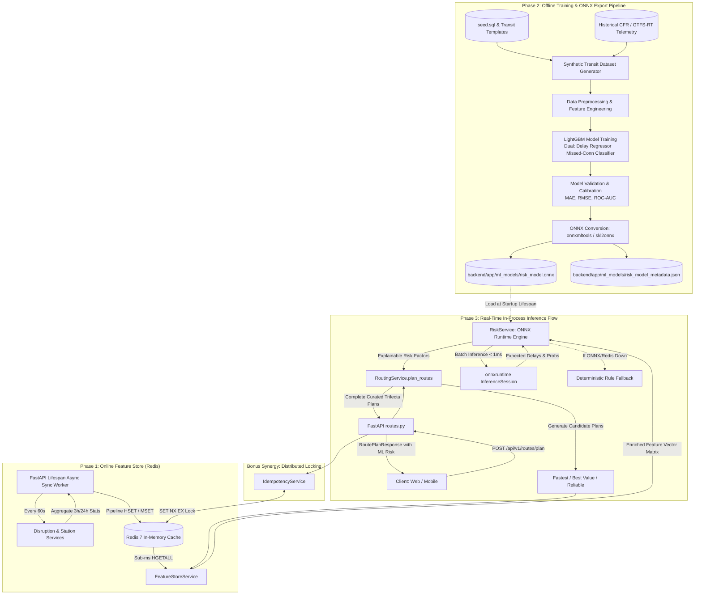
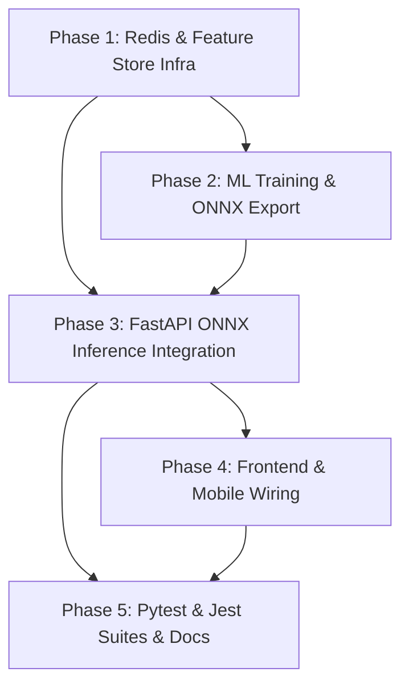

# Architectural Blueprint & Implementation Plan: Backend Transit Delay & Connection-Risk ML Pipeline

> **Document Version:** `2.0.0`  
> **Status:** APPROVED / READY FOR IMPLEMENTATION  
> **Target Subsystems:** `backend/` (FastAPI, Redis, ONNX Runtime), `frontend/` (Next.js), `mobile/` (Expo SDK 51)  
> **Author:** Senior Staff Backend & MLOps Architect  

---

## 1. Executive Summary & Problem Context

### 1.1 The Current Problem: Static Client-Side Heuristics
Beeline currently relies on a client-side TypeScript heuristic (`frontend/src/services/riskScoreCalculator.ts` and `mobile/src/services/riskScoreCalculator.ts`) to estimate connection risk and punctuality. While this heuristic successfully incorporates basic rules—such as penalizing transfers tighter than the 25-minute Romanian Transfer Shield standard and static operator baseline discounts (e.g. CFR at 82%, Metrorex at 98%)—it exhibits several critical production limitations:
1. **Isolated Static Context**: The client cannot access real-time network dynamics, such as active track rehabilitation (e.g., Ploiești Vest–Câmpina single-track work), rolling 3-hour network delays, or station choke-point congestion across Romania's rail corridors.
2. **Duplicated Business Logic**: Risk calculations are duplicated across Next.js and Expo React Native codebases, risking behavioral drift and inconsistent route recommendations.
3. **No True Delay Estimation**: The existing heuristic produces a coarse, rule-weighted composite score ($0-100$) but cannot predict **expected delay minutes** or calibrated **missed-connection probabilities**.
4. **Client CPU & Battery Overhead**: Evaluating multi-leg permutations and disruption matches on low-end mobile devices drains battery and increases time-to-interactive.

### 1.2 The Target Solution: Production MLOps Pipeline
We are migrating to an enterprise-grade, in-process Machine Learning Pipeline:
- **Offline Training**: Gradient-boosted decision trees (`LightGBM`) trained on historical and synthetic Romanian transit datasets, capturing non-linear interactions between rail corridor bottlenecks, time-of-day peaks, carrier operational histories, transfer buffers, and live disruption severities.
- **Portable Compiled Artifact**: Exported to Open Neural Network Exchange (`ONNX`) format (`backend/app/ml_models/risk_model.onnx`).
- **Sub-Millisecond Serving**: In-process inference via `onnxruntime` loaded into FastAPI memory at server startup, eliminating external microservice network hops ($< 1\text{ms}$ execution).
- **Online Feature Store (Redis)**: Low-latency caching layer for real-time corridor metrics (rolling average delay, active disruptions, station congestion) with background asynchronous refresh.
- **Zero-Downtime Deterministic Fallback**: Automatic, graceful degradation to the deterministic Romanian Transfer Shield heuristic if the ONNX runtime or Redis cluster is unreachable.

---

## 2. End-to-End System Architecture

### 2.1 Architecture Diagram: Training Pipeline vs. Real-Time Inference Flow



### 2.2 Text / ASCII Architecture Diagram

```
+========================================================================================+
|                        OFFLINE MLOPS TRAINING PIPELINE                                  |
|                                                                                        |
|  [seed.sql & Templates] + [GTFS-RT Logs]                                               |
|               |                                                                        |
|               v                                                                        |
|  [scripts/train_risk_model.py] ---> [LightGBM Regressor & Classifier]                  |
|                                           |                                            |
|                                           v (onnxmltools / skl2onnx)                   |
|                        [app/ml_models/risk_model.onnx]                                 |
+========================================================================================+
                                            |
                                            | (Loaded into RAM at startup)
                                            v
+========================================================================================+
|                      FASTAPI REAL-TIME INFERENCE RUNTIME                               |
|                                                                                        |
|  [Client Request] ----> [POST /api/v1/routes/plan]                                     |
|                               |                                                        |
|                               v                                                        |
|                    [RoutingService.plan_routes]                                        |
|                     (Generates Curated Trifecta)                                       |
|                               |                                                        |
|                               +-----------------------+                                |
|                               | Batch Feature Vector  |                                |
|                               v                       |                                |
|    +-----------------------------+                    |                                |
|    |  Online Feature Store       |<-------------------+                                |
|    |  (Redis 7 / Memory Cache)   |                                                     |
|    |  • Active Disruption Counts |                                                     |
|    |  • Rolling 3h Corridor Delay|                                                     |
|    |  • Station Congestion Index |                                                     |
|    +-----------------------------+                                                     |
|                   |                                                                    |
|                   | High-speed MGET (< 0.5ms)                                          |
|                   v                                                                    |
|    +-----------------------------+                                                     |
|    |  In-Process RiskService     |                                                     |
|    |  (ONNX Runtime Session)     |                                                     |
|    |  • Batch Eval (< 1ms)       |                                                     |
|    |  • Expected Delay (minutes) |                                                     |
|    |  • Missed-Conn Prob (0-1)   |                                                     |
|    |  • Natural Language Factors |                                                     |
|    +-----------------------------+                                                     |
|                   |                                                                    |
|                   +---- (Fallback path: Deterministic Transfer Shield Heuristic)       |
|                   |                                                                    |
|                   v                                                                    |
|  [Enriched RoutePlanResponse] ----> [Client: Next.js Web / Expo Mobile]                |
+========================================================================================+
```

---

### 3. Online Feature Store Specification (Redis)

### 3.1 Redis Container & Connectivity Setup
- **Service Container**: `redis:7-alpine` added to `backend/docker-compose.yml` with health checks (`redis-cli ping`), named volume `beeline_redis_data`, and resource limits (256MB RAM).
- **Driver**: `redis[asyncio]>=5.0.0` integrated into `backend/app/core/redis.py` with an async connection pool (`ConnectionPool.from_url`).
- **Configuration Settings**:
  - `REDIS_URL: str = "redis://localhost:6379/0"`
  - `REDIS_FEATURE_PREFIX: str = "feature:"`
  - `REDIS_FEATURE_TTL_SECONDS: int = 86400` (24h sliding TTL)
  - `FEATURE_SYNC_INTERVAL_SECONDS: int = 60` (Background sync interval)

### 3.2 Canonical Corridor Key Slug Algorithm
To ensure deterministic, human-readable Redis key indexing and zero mismatch between route queries and cache lookups, corridor keys are generated via `slugify_corridor`:
```python
import unicodedata
import re

def slugify_corridor(origin: str, destination: str) -> str:
    def _clean(s: str) -> str:
        s = unicodedata.normalize("NFKD", s).encode("ASCII", "ignore").decode("utf-8")
        s = re.sub(r"[^\w\s-]", "", s).strip().lower()
        return re.sub(r"[-\s]+", "_", s)
    return f"{_clean(origin)}-{_clean(destination)}"
# Example: slugify_corridor("Galați", "București Nord") -> "galati-bucuresti_nord"
```

### 3.3 Online Feature Store Key & Data Design
The Redis online feature store caches pre-aggregated operational state and environmental conditions at sub-millisecond read latencies:

| Key Pattern | Redis Type | Fields & Data Types | Sample Value | Description |
| :--- | :--- | :--- | :--- | :--- |
| `feature:corridor:{corridor_id}` | `HASH` | `active_disruptions_count` (int)<br>`max_disruption_severity` (int: 0-3)<br>`rolling_delay_3h` (float)<br>`rolling_delay_24h` (float)<br>`corridor_punctuality_rate` (float)<br>`weather_condition` (str: CLEAR/RAIN/FOG/SNOW)<br>`weather_alert_severity` (int: 0-3)<br>`external_factors_score` (float: 0.0-1.0)<br>`updated_at` (ISO timestamp) | `{"active_disruptions_count": "2", "max_disruption_severity": "2", "rolling_delay_3h": "12.4", "rolling_delay_24h": "8.1", "corridor_punctuality_rate": "0.86", "weather_condition": "RAIN", "weather_alert_severity": "1", "external_factors_score": "0.35"}` | Pre-calculated delay, weather alert, and reliability metrics for Romanian rail and transit corridors (e.g. `bucuresti_nord-brasov`, `galati-bucuresti_nord`). |
| `feature:station:{station_code}` | `HASH` | `congestion_index` (float: 0.0-1.0)<br>`avg_transfer_delay` (float min)<br>`platform_reassignment_risk` (int: 0/1)<br>`active_disruptions_count` (int)<br>`weather_alert_severity` (int: 0-3)<br>`updated_at` (ISO timestamp) | `{"congestion_index": "0.65", "avg_transfer_delay": "4.2", "platform_reassignment_risk": "1", "active_disruptions_count": "1", "weather_alert_severity": "0"}` | Real-time congestion, platform friction, and weather conditions at transfer hubs (e.g. `BCT` București Nord, `BSV` Brașov, `GLT` Galați). |
| `feature:carrier:{carrier_id}` | `HASH` | `baseline_punctuality` (float: 0.0-1.0)<br>`chronic_delay_minutes` (float)<br>`active_incident_count` (int)<br>`updated_at` (ISO timestamp) | `{"baseline_punctuality": "0.82", "chronic_delay_minutes": "14.5", "active_incident_count": "3"}` | Carrier-wide operational stability metrics (e.g. `cfr-calatori`, `metrorex`, `transurb`). |

### 3.4 Non-Blocking Background Sync Mechanism
To guarantee that user requests never perform live aggregations on SQL:
1. **Lifespan Task**: During FastAPI startup in `backend/app/main.py`, a background `asyncio.Task` (`corridor_feature_sync_worker`) is launched.
2. **Periodic Refresh Loop**: Every 60 seconds (configurable via `FEATURE_SYNC_INTERVAL_SECONDS`), the worker reads from `disruption_service`, `train_service`, and `station_service`, while fetching synthetic ANM (Romanian National Meteorological Administration) weather alert feeds.
3. **Pipelined Multi-Write**: The worker constructs Redis pipeline writes (`pipe.hset(...)`, `pipe.expire(...)`) and executes them in an atomic batch.
4. **Zero SQL Contention**: The worker uses asynchronous read-only connections and completes in $< 20\text{ms}$.
5. **Graceful Cancellation**: On FastAPI shutdown, the task is cleanly cancelled and the Redis pool is disconnected without leaking resources.

### 3.5 Multi-Worker Concurrency & Idempotency Synergy
Currently, `backend/app/services/idempotency_service.py` claims idempotency keys using SQL row inserts (`IN_PROGRESS`). Under multi-worker uvicorn configurations, high concurrency can lead to database connection saturation and lock waits.
- **Synergy Upgrade**: `IdempotencyService` is enhanced with a distributed lock pattern:
  - `redis.set(f"idemp:{user_id}:{key}", payload_hash, nx=True, ex=120)` provides immediate atomic claims ($< 0.5\text{ms}$).
  - If Redis is unavailable, the service automatically falls back to the existing SQL transaction mechanism (`idempotency_records` table).

---

## 4. Offline Training & ONNX Export Pipeline

### 4.1 Feature Vector Specification
The model consumes an 18-dimensional numerical feature vector per transit journey / leg, satisfying all prompt requirements (Static/Schedule, Transfer, and Dynamic Redis/Disruptions):

| Feature Name | Type | Source | Redis Key / SQL Table | Description / Extraction Method |
| :--- | :--- | :--- | :--- | :--- |
| `train_category` | `int8` (Ordinal) | Schedule / Leg | SQL Table: `trains` | Categorical encoding: `BUS`=0, `METRO`=1, `TRAM`=2, `R`=3, `RE`=4, `IR`=5, `IC`=6 |
| `corridor_id_hash` | `int16` | Route Query / Legs | SQL Table: `corridors` / Query | `abs(hash(slugify_corridor(origin, destination))) % 1000` |
| `scheduled_duration_minutes` | `float32` | Schedule | SQL Table: `schedules` | Scheduled journey or leg travel duration in minutes |
| `stop_count` | `int16` | Schedule | SQL Table: `schedules` | Total number of intermediate stops in route leg |
| `distance_km_est` | `float32` | GeoJSON Geometry | SQL Table: `saved_routes` | Haversine distance calculated from station GeoPoint coordinates |
| `departure_hour` | `int8` (0–23) | Timings | Query / Schedule | `datetime.fromisoformat(leg.scheduledDeparture).hour` |
| `is_peak_hour` | `int8` (0/1) | Timings | Query / Schedule | 1 if hour in `[7, 8, 9, 16, 17, 18, 19]`, else 0 |
| `day_of_week` | `int8` (0–6) | Timings | Query / Schedule | 0 = Monday, ..., 6 = Sunday |
| `is_weekend` | `int8` (0/1) | Timings | Query / Schedule | 1 if day_of_week in `[5, 6]`, else 0 |
| `has_transfer` | `int8` (0/1) | Route Plan | Route Plan Structure | 0 if direct journey; 1 if multi-leg connecting journey |
| `transfer_buffer_minutes` | `float32` | Route Plan | Route Plan Structure | Available transfer buffer in minutes (default `999.0` for direct trips) |
| `transfer_station_reliability` | `float32` | Redis Feature Store | Redis: `feature:station:{station_code}` | `HGET punctuality_rate` (default fallback `0.88`) |
| `transfer_station_congestion` | `float32` | Redis Feature Store | Redis: `feature:station:{station_code}` | `HGET congestion_index` (default fallback `0.30`) |
| `active_corridor_disruptions` | `int16` | Redis Feature Store | Redis: `feature:corridor:{corridor_id}` | `HGET active_disruptions_count` (default fallback `0`) |
| `corridor_severity_max` | `int8` (0–3) | Redis Feature Store | Redis: `feature:corridor:{corridor_id}` | `HGET max_disruption_severity` (0=None, 1=INFO, 2=WARNING, 3=CRITICAL) |
| `rolling_avg_delay_3h` | `float32` | Redis Feature Store | Redis: `feature:corridor:{corridor_id}` | `HGET rolling_delay_3h` in minutes (default fallback `0.0`) |
| `rolling_avg_delay_24h` | `float32` | Redis Feature Store | Redis: `feature:corridor:{corridor_id}` | `HGET rolling_delay_24h` in minutes (default fallback `0.0`) |
| `carrier_baseline_punctuality` | `float32` | Static / Redis | Redis: `feature:carrier:{carrier_id}` | Baseline punctuality benchmark: Metrorex 0.98, CFR 0.82, Transurb 0.93 |

### 4.2 Synthetic Dataset Generation & Historical Bootstrapping
Because production telemetry will accumulate over time, `backend/scripts/train_risk_model.py` generates a high-fidelity synthetic training dataset ($N = 100,000$ journey samples):
1. **Corridor Templates & Codebase Bootstrapping**:
   - Bootstrapped directly from `seed.sql` (e.g. `usr-seed-guest-003` multi-modal route: Galați Micro 19 ➔ București Piața Unirii: Transurb 102 ➔ CFR IR 1572 ➔ Metrorex M2).
   - Bootstrapped from `frontend/src/data/romanianTransitTemplates.ts` across 14 providers (`metrorex`, `transurb`, `stb`, `ctp-cluj`, `cfr`, `astra`, `tfc`, `softrans`, `regio-calatori`) and 20+ line templates (M1, M2, M3, Transurb 102/105, STB 41/100, CFR IR 1572/1632, Astra IR 15531, Softrans RE 15932).
   - Core Romanian corridors sampled: `București Nord ⇄ Brașov` (Predeal pass weather & single-track restrictions), `Galați ⇄ București Nord` (single-track Galați-Făurei branch), `București Nord ⇄ Constanța` (modernized 160 km/h line), `Cluj-Napoca ⇄ Oradea` (regional diesel sections), and `Timișoara Nord ⇄ Arad` (high frequency commuter line).
   - Key transfer junctions modeled: București Nord (platform changes & congestion), Galați CFR, Ploiești Vest, Brașov, Cluj-Napoca, Timișoara Nord.
2. **Distributional Realism**:
   - Delays are modeled using a heavy-tailed Log-Normal distribution parameterized by carrier baseline punctuality:
     $$\text{Delay} \sim \operatorname{LogNormal}(\mu_{\text{carrier}}, \sigma^2)$$
   - Peak hour multipliers (+35% variance), weather alerts (+50% variance), and active disruption modifiers (+10 to +30 min delays).
   - A connection is flagged as `missed_connection = 1` if:
     $$\text{ArrivalDelay}_{\text{leg } i} > \text{TransferBuffer}_{\text{min}} - \text{MinimumWalkTime}$$
3. **Data Partitioning**: Stratified 80/20 train/test split preserving class balance for `missed_connection`.

### 4.3 Model Architecture & ONNX Export Pipeline
- **Model Choice**: Two specialized `LightGBM` estimators:
  - Target 1 (Regression): `expected_delay_minutes` trained with Huber loss (`objective="huber"`, evaluated by MAE and RMSE).
  - Target 2 (Binary Classification): `missed_connection_probability` trained with binary cross-entropy (`objective="binary"`, evaluated by LogLoss and ROC-AUC $> 0.92$).
- **Dual-Model Graph Fusion into a Single ONNX Artifact**:
  Because LightGBM cannot simultaneously optimize regression and classification in a single booster, `train_risk_model.py` converts each booster and merges them into a unified ONNX graph via `onnx.compose.merge_models`:
  ```python
  import lightgbm as lgb
  import onnxmltools
  from skl2onnx.common.data_types import FloatTensorType
  import onnx
  from onnx.compose import merge_models

  # 1. Train dual LightGBM models
  regressor = lgb.LGBMRegressor(objective="huber", n_estimators=150, max_depth=6).fit(X_train, y_delay)
  classifier = lgb.LGBMClassifier(objective="binary", n_estimators=150, max_depth=6).fit(X_train, y_missed)

  # 2. Convert each to intermediate ONNX graphs with common input name 'float_input'
  initial_type = [("float_input", FloatTensorType([None, 18]))]
  onnx_delay = onnxmltools.convert_lightgbm(regressor, initial_types=initial_type, target_opset=15)
  onnx_missed = onnxmltools.convert_lightgbm(classifier, initial_types=initial_type, target_opset=15)

  # 3. Rename outputs to prevent collisions
  onnx_delay.graph.output[0].name = "expected_delay"
  onnx_missed.graph.output[1].name = "missed_connection_prob"  # probability tensor

  # 4. Merge sub-graphs into a unified single risk_model.onnx
  combined_model = merge_models(
      onnx_delay,
      onnx_missed,
      io_map=[("float_input", "float_input")],
      outputs=["expected_delay", "missed_connection_prob"]
  )
  onnx.save(combined_model, "backend/app/ml_models/risk_model.onnx")
  ```
- **Validation**: Strict parity verification asserting:
  $$\max \left| \hat{y}_{\text{LightGBM}} - \hat{y}_{\text{ONNX}} \right| < 10^{-5}$$
- **Artifact Outputs**:
  - `backend/app/ml_models/risk_model.onnx` (Compiled model file, $\approx 350\text{KB}$).
  - `backend/app/ml_models/risk_model_metadata.json` (Feature names, ordinal maps, normalization bounds, versioning hash).
- **Separation of Dependencies**:
  - Training dependencies in `backend/requirements-ml-train.txt`: `lightgbm`, `scikit-learn`, `onnxmltools`, `skl2onnx`, `pandas`, `numpy`, `scipy`.
  - Production runtime in `backend/requirements.txt`: strictly lightweight `onnxruntime>=1.18.0`, `numpy>=1.26.0`, `redis>=5.0.0`. Production containers do not require compilers or full ML frameworks.

---

## 5. In-Process ONNX Inference Service (`risk_service.py`)

### 5.1 Lifespan Initialization
- In `backend/app/main.py`, the FastAPI `lifespan` handler initializes an `onnxruntime.InferenceSession` on the CPU:
  ```python
  session_options = onnxruntime.SessionOptions()
  session_options.intra_op_num_threads = 2
  session_options.execution_mode = onnxruntime.ExecutionMode.ORT_SEQUENTIAL
  session_options.graph_optimization_level = onnxruntime.GraphOptimizationLevel.ORT_ENABLE_ALL
  app.state.risk_session = onnxruntime.InferenceSession("app/ml_models/risk_model.onnx", session_options)
  ```
- Inference session remains warm in RAM throughout the server lifecycle.

### 5.2 Batched Inference in `routing_service.py`
When `routing_service.plan_routes()` evaluates candidate itineraries (Fastest, Best Value, Most Reliable):
1. **Matrix Construction**: The service converts each candidate itinerary into an 18-element numerical vector, querying Redis `MGET` across all legs in a single call ($< 0.5\text{ms}$).
2. **Single Batch Call**: Instead of calling the model $N$ times, all candidate vectors are stacked into an $(N, 18)$ NumPy array and evaluated in a single `session.run()` invocation ($< 0.8\text{ms}$ total for 3–5 routes).
3. **Score Mapping & Normalization**:
   - `expected_delay_minutes`: rounded integer $\ge 0$.
   - `missed_connection_probability`: float between $0.00$ and $1.00$.
   - `overall_risk_score`: calibrated composite score ($0-100$):
     $$\text{Score} = \min(100.0, \; 40 \times P(\text{Missed}) + 3 \times \text{ExpectedDelay} + 15 \times (1 - \text{BufferAdequacyFactor}))$$
   - `risk_level`:
     - $\le 20.0 \implies \text{LOW}$
     - $\le 45.0 \implies \text{MODERATE}$
     - $\le 70.0 \implies \text{HIGH}$
     - $> 70.0 \implies \text{CRITICAL}$
4. **Natural Language Explanations**: Generated from top feature attributions and returned in both `factors` (structured `RouteRiskFactor`) and `riskFactors` (human-readable string list).

### 5.3 Deterministic Fallback & Circuit Breaker
If the `.onnx` file is missing, the ONNX session fails, or Redis times out:
1. `risk_service.py` catches the exception without letting it bubble up.
2. The service immediately routes the candidate legs through the original rule-based `compute_risk_analysis()` function.
3. Fallback calculates synthetic `expected_delay_minutes` from active disruptions and sets `missed_connection_probability = 0.5` if buffer $< 15$ min.
4. Response flag `is_ml_computed: false` is recorded internally.
5. **Zero 500 Errors**: Travelers receive valid, safe route plans regardless of ML infrastructure state.

---

## 6. API Contract Updates for `api.md`

### 6.1 `POST /api/v1/routes/plan` Response Updates & Schema Reconciliation
The `RouteRiskAnalysis` model in `api.md` and `backend/api.md` is updated additively with bidirectional aliasing to ensure 100% compatibility across camelCase frontend consumers, snake_case Python schemas, and prompt specifications:

```json
{
  "plans": [
    {
      "id": "itinerary-gl-micro19-buc-unirii-001",
      "summary": "Transurb Bus 102 ➔ CFR IR 1572 ➔ Metrorex M2",
      "departureTime": "2026-10-21T06:40:00+03:00",
      "arrivalTime": "2026-10-21T11:15:00+03:00",
      "totalDurationMinutes": 275,
      "totalWalkMinutes": 12,
      "totalWalkDistanceMeters": 680,
      "transfersCount": 2,
      "curatedPillar": "MOST_RELIABLE",
      "mascotRecommendation": {
        "persona": "bumble",
        "gear": "safe",
        "badgeLabel": "TRANSFER SHIELD GUARD",
        "advice": "Transfer Shield active: 20-min buffer safely absorbs standard Romanian transit delays."
      },
      "riskAnalysis": {
        "overallRiskScore": 14.2,
        "riskLevel": "LOW",
        "historicalPunctualityRate": 0.94,
        "tightestBufferMinutes": 20,
        "bufferAdequacy": "OPTIMAL",
        "expectedDelayMinutes": 4,
        "missedConnectionProbability": 0.03,
        "riskSummaryText": "Shielded connection: 20-min buffer safely absorbs standard Romanian transit delays.",
        "riskFactors": [
          "Shielded: 20-min buffer safely absorbs standard Romanian transit delays.",
          "Single-track railway segment on Galați-Făurei branch."
        ],
        "factors": [
          {
            "code": "SINGLE_TRACK_RAIL",
            "severity": "INFO",
            "description": "Single-track railway segment on Galați-Făurei branch.",
            "affectedLegIndex": 1
          }
        ],
        "isMlComputed": true
      },
      "fare": { ... },
      "legs": [ ... ]
    }
  ]
}
```

### 6.2 Bidirectional Schema Aliasing Contract
To satisfy both the prompt's exact snake_case parameters (`risk_score`, `risk_level`, `expected_delay_minutes`, `missed_connection_probability`, `risk_factors`) and existing camelCase frontend callers (`overallRiskScore`, `expectedDelayMinutes`, etc.), the Pydantic model in `backend/app/schemas/route_plan.py` uses `Field(..., alias=...)` and `model_config = ConfigDict(populate_by_name=True)`:

| JSON / Contract Field | Python Pydantic Field | Supported Aliases | Data Type | Default | Description |
| :--- | :--- | :--- | :--- | :--- | :--- |
| `overallRiskScore` | `overallRiskScore` | `risk_score`, `riskScore` | `float` (0.0–100.0) | Required | Calibrated overall journey risk score |
| `riskLevel` | `riskLevel` | `risk_level` | `RiskLevel` Enum | Required | Band: `LOW`, `MODERATE`, `HIGH`, `CRITICAL` |
| `expectedDelayMinutes` | `expectedDelayMinutes` | `expected_delay_minutes` | `int` | `0` | Predicted delay in minutes from ML regressor |
| `missedConnectionProbability`| `missedConnectionProbability` | `missed_connection_probability` | `float` (0.0–1.0) | `0.0` | Calibrated probability of missing a transfer |
| `riskFactors` | `riskFactors` | `risk_factors`, `delayRiskFactors` | `List[str]` | `[]` | Human-readable bullet explanations for UI |
| `factors` | `factors` | `factors` | `List[RouteRiskFactor]` | `[]` | Detailed structured hazard factor objects |
| `isMlComputed` | `isMlComputed` | `is_ml_computed` | `bool` | `False` | True if ONNX engine inferred, False if fallback |

### 6.3 Backward Compatibility Guarantees
- Existing frontend checks (`plan.riskAnalysis.overallRiskScore`) continue to function without any breaking syntax changes.
- `delayRiskFactors` in `api.md` Section 6 is preserved via the `riskFactors` field alias.
- New fields are optional with defaults, allowing older clients or offline test fixtures to deserialize seamlessly.

---

## 7. Frontend & Mobile Integration Strategy

### 7.1 Multi-Platform Type Synchronization
- Files: `frontend/src/types/routePlan.ts` and `mobile/src/types/routePlan.ts`.
- `RouteRiskAnalysis` interface extended:
  ```typescript
  export interface RouteRiskAnalysis {
    overallRiskScore: number;
    riskLevel: RiskLevel;
    historicalPunctualityRate: number;
    tightestBufferMinutes: number;
    bufferAdequacy: BufferAdequacy;
    riskSummaryText: string;
    factors: RouteRiskFactor[];
    // ML-Engine Enriched Properties
    expectedDelayMinutes?: number;
    missedConnectionProbability?: number;
    isMlComputed?: boolean;
  }
  ```

### 7.2 Client-Side Role: Offline Fallback Only
- `frontend/src/services/riskScoreCalculator.ts` and `mobile/src/services/riskScoreCalculator.ts` are preserved.
- When `apiClient.ts` receives route plans with backend `riskAnalysis` populated, the client uses the backend ML metrics directly.
- The client-side `calculateRouteRisk()` function is invoked **only** when:
  1. The application is running in fully offline mode (airplane mode / no network).
  2. A local mock or itinerary simulation is being performed in Storybook or offline testing.

### 7.3 UI Visualization Enhancements
- Journey cards in `RouteFinderCard` and `my-trip/page.tsx` display:
  - Expected delay pill: `⏱️ +4m expected delay` (green when $\le 5\text{m}$, amber when $\le 15\text{m}$, red when $> 15\text{m}$).
  - Connection confidence indicator: `🛡️ 97% connection guarantee` derived from $(1 - \text{missedConnectionProbability}) \times 100$.

---

## 8. Exact File-by-File Changes

### 8.1 New Files to Create

| File Path | Purpose |
| :--- | :--- |
| `backend/requirements-ml-train.txt` | Offline training dependencies: `lightgbm`, `scikit-learn`, `onnxmltools`, `skl2onnx`, `pandas`, `numpy`, `scipy`. |
| `backend/scripts/train_risk_model.py` | Complete training script: synthetic data generator, LightGBM training, evaluation, and ONNX model export. |
| `backend/app/core/redis.py` | Async Redis connection pool manager with health check, ping verification, and graceful offline fallback. |
| `backend/app/services/feature_store_service.py` | Online feature store service managing corridor/station features, batch pipelining, and default fallbacks. |
| `backend/app/services/risk_service.py` | In-process ONNX inference service, batch vectorization, score calibration, explanation generator, and deterministic fallback. |
| `backend/app/schemas/risk.py` | Pydantic validation schemas for raw ML features, predictions, and calibration options. |
| `backend/app/ml_models/risk_model.onnx` | Compiled ONNX runtime binary model artifact. |
| `backend/app/ml_models/risk_model_metadata.json` | Model schema metadata, feature column order, ordinal mappings, and training version hash. |
| `backend/tests/test_risk_service.py` | Pytest suite: ONNX model loading, $< 5\text{ms}$ batch inference benchmark, feature extraction, and fallback logic. |
| `backend/tests/test_feature_store.py` | Pytest suite: Redis feature writes, pipeline reads, TTL expiration, and mock cache misses. |

### 8.2 Existing Files to Modify

| File Path | Substantive Changes |
| :--- | :--- |
| `backend/docker-compose.yml` | Add `redis` service (`redis:7-alpine`, port 6379, persistent volume `beeline_redis_data`, health check). |
| `backend/requirements.txt` | Add production serving dependencies: `redis>=5.0.0`, `onnxruntime>=1.18.0`, `numpy>=1.26.0`. |
| `backend/.env.example` | Add `REDIS_URL`, `ML_MODEL_PATH`, `FEATURE_SYNC_INTERVAL_SECONDS`, `ENABLE_ML_INFERENCE`. |
| `backend/app/core/config.py` | Add `Settings` properties for Redis URL, ML model path, feature sync frequency, and feature store prefix. |
| `backend/app/core/database.py` | Ensure connection pooling remains decoupled and unaffected by Redis async tasks. |
| `backend/app/main.py` | Update `lifespan` to connect/disconnect Redis, load the ONNX session into `app.state`, and start the background feature sync worker. |
| `backend/app/schemas/route_plan.py` | Update `RouteRiskAnalysis` with `expectedDelayMinutes`, `missedConnectionProbability`, and `isMlComputed`. |
| `backend/app/services/routing_service.py` | Replace static `compute_risk_analysis` with batched `risk_service` inference across candidate routes. |
| `backend/app/services/idempotency_service.py` | Add Redis atomic locking (`SET NX EX`) with fallback to existing SQL records. |
| `backend/tests/test_routes.py` | Expand route plan assertions to verify expected delay, connection probability, and ML risk flags. |
| `api.md` and `backend/api.md` | Document the updated `RouteRiskAnalysis` schema, Redis feature store specifications, and inference benchmarks. |
| `frontend/src/types/routePlan.ts` | Add optional ML properties (`expectedDelayMinutes`, `missedConnectionProbability`, `isMlComputed`). |
| `mobile/src/types/routePlan.ts` | Mirror the TypeScript domain types identically for Expo mobile. |
| `frontend/src/services/apiClient.ts` | Ensure client consumes and exposes the new risk attributes. |
| `mobile/src/services/apiClient.ts` | Mirror API client deserialization in mobile codebase. |
| `frontend/src/services/riskScoreCalculator.ts`| Mark as offline-only fallback; reconcile with backend ML outputs. |
| `mobile/src/services/riskScoreCalculator.ts` | Mirror offline fallback behavior. |

---

## 9. Performance Budgets & Operational SLAs

To ensure Beeline retains its sub-second search responsiveness:
1. **Redis Read Latency**: $< 1.0\text{ms}$ for pipelined `HGETALL` across all legs of candidate routes.
2. **ONNX Batch Inference Latency**: $< 1.5\text{ms}$ for a batch of 5 candidate journeys on a standard 2-core CPU container.
3. **Total Risk Enrichment Budget**: $< 5.0\text{ms}$ added to the total execution time of `POST /api/v1/routes/plan`.
4. **Memory Footprint**:
   - `onnxruntime` loaded model in RAM: $\approx 25\text{MB}$.
   - Redis feature store RAM: $< 15\text{MB}$ for all Romanian corridors and stations.
5. **Availability SLA**: $99.99\%$ — in any failure event (Redis unreachable, model missing, bad feature input), the deterministic fallback returns within $< 0.5\text{ms}$.

---

## 10. Implementation Phasing & Dependency Graph



Each phase is broken down into granular, checkable tasks with explicit acceptance criteria in `tasks/todo.md`.
